<p align="center"><b>English</b> | <a href="README.tr.md">Türkçe</a></p>

<p align="center">
  
</p>

<p align="center">
  
  
  
  
</p>

<p align="center">
  <b>Deployment repository for Horus</b> - everything you need to install, update, back up and restore Horus from
  pre-built, signed container images. <b>No source code is required or included.</b>
</p>

---

## Table of contents

- [What is Horus?](#what-is-horus)
- [Capabilities](#capabilities)
- [Architecture](#architecture)
- [Support matrix](#support-matrix)
- [Quick start](#quick-start)
- [Prerequisites](#prerequisites)
- [Installation by operating system](#installation-by-operating-system)
- [Complete installation guide](#complete-installation-guide)
- [Scripts](#scripts)
- [Updating Horus](#updating-horus)
- [Backup, restore and rollback](#backup-restore-and-rollback)
- [Verification and health checks](#verification-and-health-checks)
- [Security notes](#security-notes)
- [Screenshots](#screenshots)
- [Troubleshooting](#troubleshooting)
- [FAQ](#faq)
- [Repository layout](#repository-layout)
- [Next steps](#next-steps)

---

## What is Horus?

**Horus is a self-hosted security and operations platform for Linux server fleets.** It gives system and security
teams one place to see the security posture of every server, find what is wrong, and fix it in a controlled,
auditable way - over plain SSH, without installing anything on the servers.

**The problem it solves.** In most environments the security state of Linux servers is spread across many tools:
vulnerability scanners, SIEM alerts, spreadsheets of users and sudo rights, firewall rules edited by hand, and
ad-hoc scripts. Changes are hard to review and harder to undo. Horus brings inventory, findings, events and
remediation together and puts every change behind dry runs, approvals, verification and rollback.

**Technically**, Horus is a containerised web application (API, background workers, scheduler, web UI) backed by
PostgreSQL and Redis. It connects to managed servers over SSH and runs hardened, allow-listed Ansible playbooks;
it integrates with **Wazuh** for vulnerabilities and alerts and with **Falco** for runtime security events.

**Who it is for**

| Audience | Typical use |
|---|---|
| System administrators | Inventory, packages and patching, Linux users, services, firewall rules |
| Security teams / SOC | Findings, vulnerabilities, runtime events, incidents, threat hunting |
| DevOps / SRE | Configuration and capacity drift, services and SLOs, change and maintenance windows |
| IT / compliance | Baselines and compliance reporting, audit trail, access reviews, backup verification |

---

## Capabilities

<table>
<tr><td width="50%" valign="top">

**Fleet and asset management**
- Linux server inventory discovered over SSH (OS, kernel, CPU, memory, disks, services, open ports)
- Host keys pinned on first contact; one dynamic inventory - no static inventory files
- Optional lightweight agent for read-only telemetry

**Security visibility**
- Security score per server and across the fleet
- Security findings mapped to baselines and compliance frameworks
- SSH configuration, sudo privileges, kernel and sysctl hardening, exposure, certificates, file integrity

**Vulnerability management**
- Vulnerability import from **Wazuh**, grouped by server and package
- Controlled package patching and a guided **kernel patch** flow (install, reboot, verify, clean up)

**Runtime security**
- **Falco** event ingestion per server with triage, correlation and incident creation
- Optional Falco on the Docker host itself

</td><td width="50%" valign="top">

**Controlled automation**
- SSH + Ansible based remediation with **dry run, approval, verification and rollback**
- Operation modes: observe, approval-required, autonomous; four-eyes approvals for production
- **Firewall rule management** (ufw, firewalld, nftables, iptables) with commit-confirm auto-rollback
- **Linux user management**: users, SSH keys, sudo, just-in-time access, break glass

**Operations**
- Package and update visibility, repository management
- **Configuration drift** and **capacity** tracking
- Backup verification policies and database restore tests
- Jobs, change and maintenance windows, runbooks

**Governance**
- **Role-based access control** with predefined roles
- Complete **audit trail** of logins, changes and approvals
- Policy-driven scoring, baselines and compliance views

</td></tr>
</table>

**Distribution and integrity**
- Multi-architecture images (**linux/amd64** and **linux/arm64**) - Docker selects the right one automatically
- Images published to **Docker Hub**, deployment files published in **this repository**
- Every release image is **signed with Cosign**; scripts verify signatures and digests before starting anything
- Scripted, verified **install, update, backup, restore and rollback**

**Integrations available today:** Wazuh (vulnerabilities and alerts), Falco (runtime events), Slack, Microsoft Teams,
generic webhooks, e-mail (SMTP), MISP and AbuseIPDB (threat intelligence), GLPI (CMDB and tickets), FortiGate
(network firewall) and HashiCorp Vault (secret backend). Integrations are configured in the web UI; their secrets are
stored encrypted.

---

## Architecture

Horus is distributed as **two things that are deliberately kept apart**:

1. **Container images** on Docker Hub - the application itself, built and signed by the Horus release pipeline.
2. **This deployment repository** - Compose files, configuration templates and operational scripts that you clone
   and run. It contains no application source code.

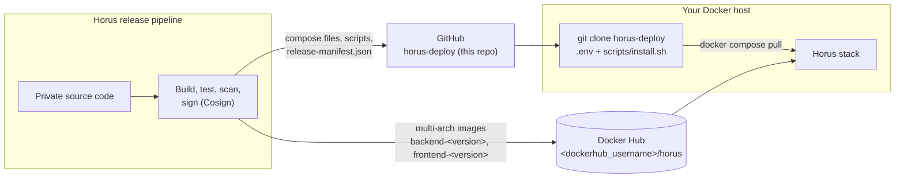

**Runtime topology** - only nginx is reachable from outside; everything else stays on internal Docker networks:

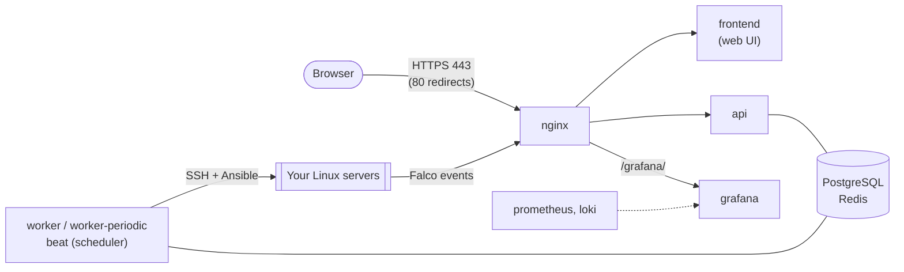

| Component | Image | Role |
|---|---|---|
| `api`, `worker`, `worker-periodic`, `beat` | `<dockerhub_username>/horus:backend-<version>` | One backend image; the services differ only by command |
| `frontend` | `<dockerhub_username>/horus:frontend-<version>` | Web UI |
| `nginx`, `postgres`, `redis`, `prometheus`, `loki`, `grafana` | Official upstream images, pinned versions | Reverse proxy, data, monitoring |
| `horus-init` | `alpine` | One-shot: generates missing secrets into the `horus_secrets` volume |
| `falco` *(optional profile)* | `falcosecurity/falco` | Runtime security of the Docker host |
| Wazuh stack *(optional file)* | `wazuh/wazuh-*` | Bundled single-node Wazuh (`docker-compose.wazuh.yml`) |

---

## Support matrix

| Platform | Status | Notes |
|---|---|---|
| **Ubuntu / Debian, x86_64** | ✅ Recommended for production | Docker Engine; supports every component, including the bundled Wazuh |
| **Linux, ARM64** (e.g. Graviton, Ampere) | ✅ Supported | Native arm64 images; the **bundled Wazuh stack is x86_64-only** |
| **macOS, Intel** | ✅ Evaluation / development | Docker Desktop |
| **macOS, Apple Silicon** | ✅ Evaluation / development | Docker Desktop; arm64 images are selected automatically |
| **Windows 10 / 11 (x86_64)** | ✅ Evaluation / development | Docker Desktop + **WSL2**, Linux containers mode; run the scripts inside WSL |
| **Windows on ARM** | ⚠️ Best effort, not tested | Docker Desktop for Windows on ARM + WSL2 (arm64 images) |
| **Native Windows containers** | ❌ Not supported | Horus images are Linux containers |

| Requirement | Minimum |
|---|---|
| Docker | Docker Engine 24+ (Linux) or a current Docker Desktop (macOS / Windows) |
| Docker Compose | **v2.24 or newer** (`docker compose version`) - checked by the scripts |
| Shell tools | POSIX `sh`, `git`, `openssl`, `curl`, `awk` (preinstalled on Linux and macOS, available in WSL) |

> [!TIP]
> **Recommended production setup:** a dedicated Ubuntu 22.04/24.04 LTS or Debian 12 x86_64 VM with 4+ vCPU,
> 8+ GB RAM (16 GB with the bundled Wazuh), 50+ GB SSD, a DNS name and a CA-issued TLS certificate.

---

## Quick start

> [!NOTE]
> This is the shortest path to a running instance. Read [Prerequisites](#prerequisites) and the
> [complete installation guide](#complete-installation-guide) before going to production.

```bash
# 1. Get the deployment files (use the tag of the release you want to run)
git clone --branch v1.0.0 https://github.com/doganyesilkir/horus-deploy.git
cd horus-deploy

# 2. Create your configuration
cp .env.example .env
chmod 600 .env
${EDITOR:-nano} .env        # set at least HORUS_DOMAIN and HORUS_ADMIN_PASSWORD (see below)

# 3. Install - pulls the images, starts the stack and verifies it
./scripts/install.sh --self-signed     # or without --self-signed when you have a certificate in nginx/certs/
```

Then open `https://<HORUS_DOMAIN>/`, sign in as `admin` with `HORUS_ADMIN_PASSWORD` and choose a new password.

**What happens automatically**

- **Images are pulled from Docker Hub.** `install.sh` runs `docker compose pull`; you never download images by
  hand. Docker picks the `linux/amd64` or `linux/arm64` variant that matches your host.
- **Secrets are generated.** Every secret left empty in `.env` (database, Redis, JWT, master key …) is created once
  in the `horus_secrets` Docker volume.
- **Signatures are verified when `cosign` is installed.** The installer checks both images against the release's
  signing identity and **refuses to install** if verification fails. Use `--require-signature` to make
  verification mandatory even when `cosign` is missing.
- **The result is checked.** The installer waits for every health check and runs `scripts/verify.sh` (HTTPS, HSTS,
  redirects, container hardening).

> [!IMPORTANT]
> In a **release checkout** (`git clone --branch vX.Y.Z`), `.env.example` already contains the image name, version,
> image digests and signing identity of that release, taken from `release-manifest.json`. If you start from another
> branch, fill in `HORUS_IMAGE` and `HORUS_VERSION` yourself (see [Configure .env](#2-configure-env)).

---

## Prerequisites

### Docker

- **Linux:** Docker Engine 24+ with the Compose plugin v2.24+.
- **macOS / Windows:** Docker Desktop (includes Compose v2). On Windows, WSL2 and **Linux containers** mode are
  required.
- Horus runs **Linux containers only**.

### Resources

| Resource | Minimum | Recommended | With bundled Wazuh |
|---|---|---|---|
| CPU | 2 cores | 4 cores | 6+ cores |
| Memory | 6 GB | 8 GB | 16 GB |
| Disk | 20 GB free | 50 GB SSD | 100 GB SSD |

The installer warns when less than 5 GB is free in the deployment directory. `HORUS_WORKER_CPUS` in `.env`
(default `2.0`) must not exceed the number of CPUs of the host.

### Network and ports

| Port (host) | Purpose | Variable |
|---|---|---|
| `443/tcp` | Horus web UI and API (HTTPS) | `HORUS_HTTPS_PORT` |
| `80/tcp` | Redirect to HTTPS (`https` mode) or plain HTTP (`http-dev` mode) | `HORUS_HTTP_PORT` |
| `1514/tcp`, `1515/tcp` | Wazuh agents - bundled Wazuh only | - |
| `127.0.0.1:8443` | Wazuh dashboard - bundled Wazuh only, loopback by default | `WAZUH_DASHBOARD_BIND`, `WAZUH_DASHBOARD_PORT` |

Outbound: SSH (`22/tcp` or your SSH port) from the Docker host to the servers Horus manages, and HTTPS to Docker
Hub for pulling images. PostgreSQL, Redis, the API, Prometheus and Loki are **never** published on the host.

### DNS and TLS

- Give Horus a DNS name (for example `horus.example.com`) and set it as `HORUS_DOMAIN`.
- **Production:** put a CA-issued certificate into `nginx/certs/fullchain.pem` and `nginx/certs/privkey.pem`.
- **Evaluation:** `./scripts/install.sh --self-signed` creates a temporary self-signed certificate for
  `HORUS_DOMAIN` (browsers will show a warning). Replace it with a real certificate before production use.

### Image access

Horus images are pulled from the Docker Hub repository named in `HORUS_IMAGE` (`<dockerhub_username>/horus`).
If that repository is **public**, no login is needed. If you received access to a **private** repository, run
`docker login` with the credentials you were given before installing.

### Wazuh (optional)

- **External Wazuh:** nothing extra on the Docker host - configure the connection in `.env` or in the UI.
- **Bundled Wazuh** (`docker-compose.wazuh.yml`): x86_64 Linux only, +8 GB RAM, and on the host:

  ```bash
  sudo sysctl -w vm.max_map_count=262144
  echo 'vm.max_map_count=262144' | sudo tee /etc/sysctl.d/99-wazuh.conf
  ```

---

## Installation by operating system

Each section below is a complete, copy-paste path. Longer, step-by-step guides with screenshots of the expected
output live in [`docs/en/`](docs/en/).

### Ubuntu / Debian Linux

```bash
# Docker Engine + Compose plugin from Docker's official repository (Ubuntu; for Debian replace "ubuntu" with "debian")
sudo apt-get update
sudo apt-get install -y ca-certificates curl git openssl
sudo install -m 0755 -d /etc/apt/keyrings
sudo curl -fsSL https://download.docker.com/linux/ubuntu/gpg -o /etc/apt/keyrings/docker.asc
sudo chmod a+r /etc/apt/keyrings/docker.asc
echo "deb [arch=$(dpkg --print-architecture) signed-by=/etc/apt/keyrings/docker.asc] https://download.docker.com/linux/ubuntu $(. /etc/os-release && echo "$VERSION_CODENAME") stable" \
  | sudo tee /etc/apt/sources.list.d/docker.list > /dev/null
sudo apt-get update
sudo apt-get install -y docker-ce docker-ce-cli containerd.io docker-buildx-plugin docker-compose-plugin
sudo usermod -aG docker "$USER"      # log out and back in afterwards

# Horus
git clone --branch v1.0.0 https://github.com/doganyesilkir/horus-deploy.git && cd horus-deploy
cp .env.example .env && chmod 600 .env && nano .env
./scripts/install.sh --self-signed   # or: put your certificate into nginx/certs/ and run ./scripts/install.sh

# Check
docker compose ps
./scripts/verify.sh
```

Open `https://<HORUS_DOMAIN>/`. Full guide: [docs/en/installation-linux.md](docs/en/installation-linux.md).

### Linux ARM64

Horus images are **multi-architecture**: the same tag contains a `linux/amd64` and a `linux/arm64` image, and Docker
pulls the one matching your CPU automatically:

```text
<dockerhub_username>/horus:backend-X.Y.Z
├── linux/amd64   → Intel / AMD servers
└── linux/arm64   → ARM servers (Graviton, Ampere, Apple Silicon, …)
```

You never choose the architecture. The steps are identical to the Ubuntu / Debian section above.

> [!WARNING]
> The **bundled Wazuh stack** (`docker-compose.wazuh.yml`) is x86_64-only. On ARM64, connect Horus to a Wazuh server
> running elsewhere instead.

### macOS (Intel)

1. Install [Docker Desktop for Mac](https://docs.docker.com/desktop/setup/install/mac-install/) and start it.
2. In *Settings → Resources*, give Docker at least **4 CPUs and 8 GB of memory**.
3. In Terminal:

```bash
git clone --branch v1.0.0 https://github.com/doganyesilkir/horus-deploy.git ~/horus-deploy && cd ~/horus-deploy
cp .env.example .env && chmod 600 .env && open -e .env      # set HORUS_DOMAIN=localhost and HORUS_ADMIN_PASSWORD
./scripts/install.sh --self-signed
```

Open `https://localhost/`. On an Intel Mac, Docker Desktop pulls the `linux/amd64` images. Full guide:
[docs/en/installation-macos.md](docs/en/installation-macos.md).

### macOS (Apple Silicon)

Same steps as macOS Intel. Docker Desktop pulls the **arm64** (`linux/arm64`) images automatically - no Rosetta and
no extra flags.

> [!NOTE]
> On macOS, use Horus for evaluation and development. The optional **Falco** profile needs a Linux host kernel and
> the **bundled Wazuh** stack is x86_64-only, so neither runs under Docker Desktop on a Mac.

### Windows 10 / 11

Horus runs on Windows through **Docker Desktop with the WSL2 backend**. Run every command **inside a WSL Linux
distribution (e.g. Ubuntu)**, not in PowerShell: the scripts are POSIX shell scripts that need Linux file
permissions and Unix line endings.

```powershell
# PowerShell (as Administrator) - once
wsl --install -d Ubuntu
```

1. Install [Docker Desktop for Windows](https://docs.docker.com/desktop/setup/install/windows-install/), enable
   **Use the WSL 2 based engine**, and keep **Linux containers** mode (the default).
2. In *Settings → Resources → WSL integration*, enable integration for **Ubuntu**.
3. Open the **Ubuntu** terminal and run:

```bash
cd ~                                   # inside the WSL file system - not /mnt/c/...
git clone --branch v1.0.0 https://github.com/doganyesilkir/horus-deploy.git && cd horus-deploy
cp .env.example .env && chmod 600 .env && nano .env     # HORUS_DOMAIN=localhost, HORUS_ADMIN_PASSWORD=...
./scripts/install.sh --self-signed
```

Open `https://localhost/` in your Windows browser. Full guide: [docs/en/installation-windows.md](docs/en/installation-windows.md).

> [!CAUTION]
> Do not clone into `C:\...` or `/mnt/c/...` and do not clone with Git for Windows: `chmod` has no effect there and
> CRLF line endings break the shell scripts (`/bin/sh^M: bad interpreter`).

### Windows on ARM

Docker Desktop for Windows on ARM with WSL2 uses the **arm64** Horus images; the installation steps are the same as
for Windows 10 / 11. This combination is **not tested** by the Horus release pipeline - use it for evaluation only.

---

## Complete installation guide

### 1. Clone the deployment repository

```bash
git clone --branch v1.0.0 https://github.com/doganyesilkir/horus-deploy.git
cd horus-deploy
```

Each release of Horus is a tag in this repository. A release checkout contains:

| File | Purpose |
|---|---|
| `release-manifest.json` | The release's exact image references (repository, tag, **sha256 digests**, platforms), the **signing identity**, SBOM file names and agent checksums |
| `.env.example` | Configuration template, pre-filled with the image, version, digests and signing identity of the release |
| `RELEASE_NOTES.md`, `VERSION` | What changed, migration and rollback notes |

### 2. Configure `.env`

```bash
cp .env.example .env
chmod 600 .env
```

`.env` holds your configuration and possibly secrets - it is ignored by git and must stay readable by
administrators only. The most important settings:

| Variable | Required | Description |
|---|---|---|
| `HORUS_IMAGE` | ✅ | Image repository, `<dockerhub_username>/horus` (no tag) |
| `HORUS_VERSION` | ✅ | Exact release, e.g. `1.0.0`. Images used: `backend-<version>` and `frontend-<version>`. `latest` is refused |
| `HORUS_BACKEND_DIGEST`, `HORUS_FRONTEND_DIGEST` | Recommended | `sha256:` digests from `release-manifest.json` - pin the exact images; **required for signature verification** |
| `HORUS_SIGNING_IDENTITY` | Recommended | `signature.identity` from `release-manifest.json`, copied verbatim |
| `HORUS_DOMAIN` | ✅ | DNS name users open (also used for the self-signed certificate) |
| `HORUS_ADMIN_PASSWORD` | ✅ new installs | First administrator password - strong and unique; weak values are refused |
| `HORUS_PROXY_MODE` | | `https` (default) or `http-dev` (plain HTTP, development only) |
| `HORUS_HTTPS_PORT`, `HORUS_HTTP_PORT`, `HORUS_BIND_ADDRESS` | | Published ports and bind address of nginx |
| `HORUS_OPERATION_MODE` | | `OBSERVE`, `APPROVAL` (default) or `AUTONOMOUS` |
| `HORUS_ALLOW_SELF_APPROVAL` | | `true` for single-admin installs, `false` for the four-eyes principle |
| `HORUS_WORKER_CPUS` | | CPU limit of the automation worker - must not exceed the host's CPUs |
| `HORUS_IP_WHITELIST` | | IPs/CIDRs that automation must never block (add your admin networks) |

The full reference, including Wazuh, Vault and password policy settings, is in
[docs/en/configuration.md](docs/en/configuration.md).

**Taking the values from `release-manifest.json`** (already done for you in a release checkout):

```bash
jq -r '.backend.digest, .frontend.digest, .signature.identity' release-manifest.json
```

**Secrets.** Leave `HORUS_MASTER_KEY`, `HORUS_JWT_SECRET`, `POSTGRES_PASSWORD`, `REDIS_PASSWORD`,
`GRAFANA_ADMIN_PASSWORD` and `HORUS_INGEST_TOKEN` empty to have them generated once into the `horus_secrets` volume,
or set your own (for example with `openssl rand -hex 32`).

> [!WARNING]
> The **master key** encrypts stored SSH keys and integration secrets. If it is lost, they cannot be recovered.
> Back it up with `scripts/backup.sh` (the archive includes the secrets volume) or manage the value yourself.

### 3. TLS certificate

```bash
# production: copy your certificate and key
cp /path/to/fullchain.pem nginx/certs/fullchain.pem
cp /path/to/privkey.pem   nginx/certs/privkey.pem
chmod 0644 nginx/certs/fullchain.pem && chmod 0640 nginx/certs/privkey.pem
```

Without a certificate, use `./scripts/install.sh --self-signed` for a temporary self-signed one.

### 4. Install

```bash
./scripts/install.sh                      # certificate in nginx/certs/
./scripts/install.sh --self-signed        # temporary self-signed certificate
./scripts/install.sh --require-signature  # refuse to install unless cosign verifies both images
```

`install.sh` performs, in order:

1. **Preflight** - Docker and Compose versions, `.env` present and `chmod 600`, image settings (no `latest`, digest
   format), worker CPU limit, TLS files, free disk space, `docker compose config`.
2. **Signature verification** - when `cosign` is installed (mandatory with `--require-signature`).
3. **Image pull** - `docker compose pull` (skipped with `--no-pull` for images already loaded locally).
4. **Start** - `docker compose up -d`, then waits until every service is healthy.
5. **Verification** - runs `scripts/verify.sh` and records the installed images in `.horus-deployments`.

Start-up order: `horus-init` (secrets) → `postgres`, `redis`, `grafana` → `api` (waits for the database, applies
migrations, creates the first administrator) → `worker`, `worker-periodic`, `beat`, `frontend` → `nginx`.

### 5. First login and first security steps

1. Open `https://<HORUS_DOMAIN>/` and sign in with `HORUS_ADMIN_USERNAME` (default `admin`) and
   `HORUS_ADMIN_PASSWORD`. You are asked to set a new password immediately.
2. Remove `HORUS_ADMIN_PASSWORD` from `.env` after the first login - it is only used to create the first account.
3. Create **personal accounts** with the least privileged role that fits (`super_admin`, `security_admin`,
   `system_admin`, `security_analyst`, `auditor`, `viewer`) instead of sharing `admin`.
4. Review **Settings**: operation mode, approvals, password policy, schedules.
5. Add your management networks to `HORUS_IP_WHITELIST` so automation can never block them.

### 6. Integrations

Integrations are configured in the web UI under **Integrations** (connection test included; secrets are stored
encrypted). Wazuh can also be preconfigured in `.env`. See [docs/en/integrations.md](docs/en/integrations.md) for Wazuh
(external or bundled), Falco and notification channels.

---

## Scripts

All scripts live in [`scripts/`](scripts/), run from the repository root, never print secret values and stop on
the first error.

| Script | Purpose | When | Example |
|---|---|---|---|
| `install.sh` | Preflight, signature check, pull, start, health wait, verify | First installation | `./scripts/install.sh --self-signed` |
| `update.sh` | Preflight, pull + signature check, schema check, **backup**, record, start, verify | New release | `./scripts/update.sh 1.1.0 sha256:<backend> sha256:<frontend>` |
| `rollback.sh` | Return to the release recorded before the last update | An update misbehaves | `./scripts/rollback.sh` |
| `backup.sh` | Database dump + secrets volume + `.env` into one archive | Regularly, before changes | `./scripts/backup.sh backups` |
| `restore.sh` | Restore an archive (also on a new host) | Disaster recovery, migration | `./scripts/restore.sh backups/horus-<ts>.tar.gz` |
| `verify.sh` | Health, HTTPS, HSTS, redirect, container hardening checks | After install / update, any time | `./scripts/verify.sh` |
| `verify-signatures.sh` | Cosign verification of both configured images | Before install / update | `./scripts/verify-signatures.sh` |
| `wazuh-init.sh` | Writes the Wazuh indexer user hashes from your `.env` passwords | Once, before the bundled Wazuh | `./scripts/wazuh-init.sh` |
| `init-secrets.sh` | Generates missing secrets into the `horus_secrets` volume | **Automatic** (run by the `horus-init` container) | - |

`scripts/lib.sh` contains the shared helpers and is not run directly. Detailed behaviour and options:
[docs/en/operations.md](docs/en/operations.md).

---

## Updating Horus

```bash
git fetch --tags && git checkout v1.1.0            # deployment files of the new release
cat RELEASE_NOTES.md                               # breaking changes, migrations, rollback notes
jq -r '.backend.digest, .frontend.digest' release-manifest.json
./scripts/update.sh 1.1.0 sha256:<backend digest> sha256:<frontend digest>
```

`update.sh` will:

1. run the preflight and pull the new images;
2. verify their signatures (when `cosign` is installed and both digests are given);
3. **refuse** to continue if the new release does not know the current database schema (prevents downgrades);
4. write a backup to `backups/` and record the running release in `.horus-deployments`;
5. set `HORUS_VERSION` and the digests in `.env`, start the new release (migrations run in the `api` container) and
   verify health.

> [!TIP]
> **Digest pinning** makes the deployment immutable: a tag could be moved, a digest cannot. With both digests set,
> exactly the images that were signed and tested are started.

> [!NOTE]
> `git checkout` of a newer tag may update `.env.example`, compose files and scripts. Your `.env` is never
> overwritten - compare it with the new `.env.example` for new settings.

---

## Backup, restore and rollback

| Situation | Use |
|---|---|
| Regular protection, before maintenance | `./scripts/backup.sh` |
| The last update behaves badly, **no schema change** | `./scripts/rollback.sh` |
| The last update behaves badly, **schema changed** | `./scripts/rollback.sh --with-backup` |
| Data loss, corruption, moving to a new host | `./scripts/restore.sh <archive>` |

### Backup

```bash
./scripts/backup.sh            # -> backups/horus-<timestamp>.tar.gz (mode 600)
./scripts/backup.sh /srv/horus-backups
```

The archive contains a PostgreSQL dump (`horus.dump`), the secrets volume (`secrets.tar.gz`, including the master
key) and your `.env`.

> [!WARNING]
> A backup archive contains **every secret** of the installation. Store it encrypted and offline, and restrict
> access to it like a password vault.

### Restore

```bash
./scripts/restore.sh backups/horus-20260101T020000Z.tar.gz
```

The restore checks the archive, restores the secrets volume, restores the database into a separate database in one
transaction, **refuses a backup from a newer release**, switches databases and keeps the previous one as
`horus_pre_restore_<timestamp>`. On a **new host**:

```bash
git clone --branch v1.0.0 https://github.com/doganyesilkir/horus-deploy.git && cd horus-deploy
tar -xzf /path/horus-<ts>.tar.gz env && mv env .env && chmod 600 .env
./scripts/install.sh --self-signed     # or with your certificate in nginx/certs/
./scripts/restore.sh /path/horus-<ts>.tar.gz
```

> [!NOTE]
> A new host has no database yet, so `install.sh` needs `HORUS_ADMIN_PASSWORD`. If the restored `.env` no longer
> contains it, set a temporary strong value for the installation - the restore replaces all accounts with the ones
> from the backup, and you can remove the value again afterwards.

### Rollback

```bash
./scripts/rollback.sh                 # images only - allowed when the schema did not change
./scripts/rollback.sh --with-backup   # images + the backup taken by update.sh (later changes are lost)
```

Database migrations are forward-only; each release note states whether it contains migrations.

---

## Verification and health checks

```bash
docker compose ps                     # every service "running" / "healthy" (horus-init exits after start-up)
./scripts/verify.sh                   # health, HTTPS, HSTS, redirect, hardening
./scripts/verify-signatures.sh        # image signatures (needs cosign, digests and HORUS_SIGNING_IDENTITY)
curl -fsk https://localhost/api/v1/health
docker compose logs --tail 100 api
```

`verify.sh` checks that:

- all services are running and healthy;
- the API answers over HTTPS with an **HSTS** header, HTTP redirects to HTTPS and the web UI loads;
- `/metrics` is not reachable through the proxy;
- every container runs **non-root**, with a **read-only** root filesystem, **all capabilities dropped**,
  `no-new-privileges`, no privileged mode, no host network / PID / IPC namespace and **no Docker socket**;
- only nginx publishes ports.

**A successful installation** ends with `[verify] ok ...` for every check, `docker compose ps` shows no unhealthy
service, and you can sign in to the web UI.

---

## Security notes

> [!IMPORTANT]
> **Never keep default or example secrets.** Leave secrets empty (generated per installation) or set long random
> values (`openssl rand -hex 32`). `HORUS_ADMIN_PASSWORD` must be strong and is rejected when it is weak.

- **TLS in production.** Use a CA-issued certificate. `HORUS_PROXY_MODE=http-dev` disables TLS and is for isolated
  development only.
- **Change the first password** and create personal accounts; give each person the least privileged role.
- **Restrict exposure.** Allow `443/80` only from the networks that need the UI; Horus publishes nothing else. With
  the bundled Wazuh, restrict `1514/1515` to your servers and keep the dashboard on `127.0.0.1`.
- **Verify what you run.** Install `cosign`, pin the digests and use `install.sh --require-signature`. Signatures
  prove that an image was produced by the official Horus release workflow and was not modified.
- **What "no source code" means.** The deployment repository contains no application source code, and the images
  ship compiled modules. A downloaded image can still be inspected like any software you run - security relies on
  signatures, least privilege and keeping secrets out of images, not on secrecy.
- **Container hardening** is verified on every install and update by `verify.sh` (non-root, read-only, no
  capabilities, no Docker socket).
- **Protect backups and `.env`** - they contain the master key and credentials.
- **Automation safety.** Keep `HORUS_OPERATION_MODE=APPROVAL` until you trust your policies; set
  `HORUS_ALLOW_SELF_APPROVAL=false` in teams; list your management networks in `HORUS_IP_WHITELIST`.

See also [SECURITY.md](SECURITY.md).

---

## Screenshots

> [!NOTE]
> The screenshots below were taken from a running Horus installation with lab servers (English UI, dark theme). To
> replace one, save the new screenshot under the same file name in [`docs/images/`](docs/images/) - see
> [docs/images/README.md](docs/images/README.md).

<p align="center">
  <br>
  <sub><b>Dashboard</b> - fleet security score, open findings, jobs and alerts at a glance</sub>
</p>

<table>
  <tr>
    <td width="50%" align="center">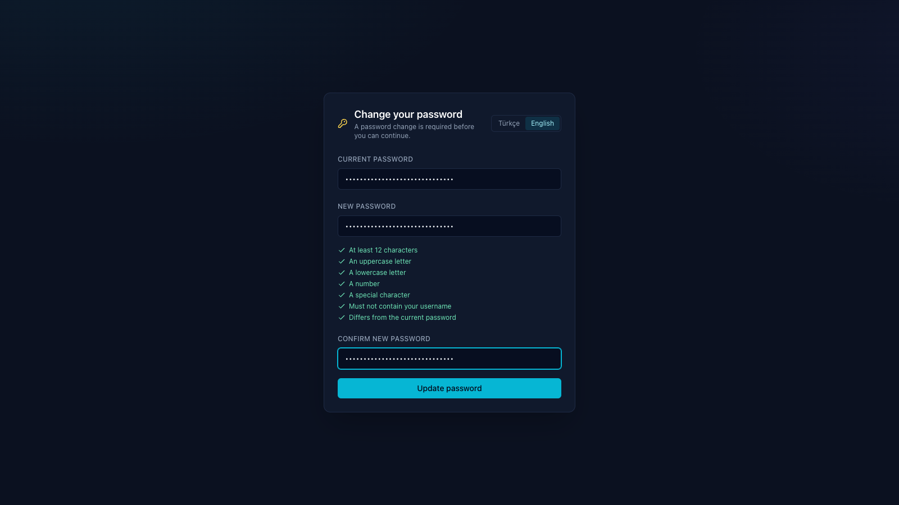<br><sub><b>Login</b> - forced password change at first sign-in</sub></td>
    <td width="50%" align="center">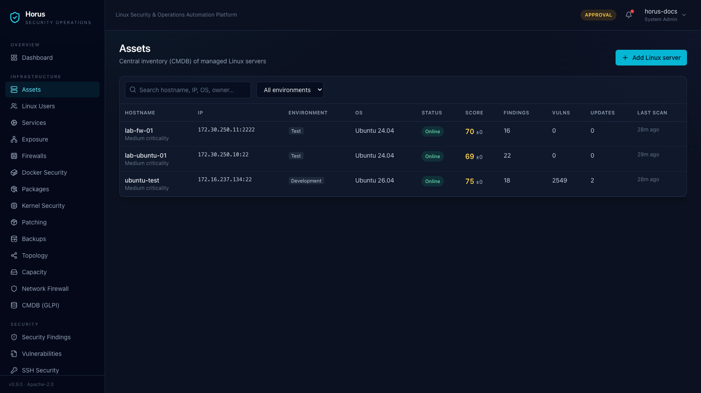<br><sub><b>Assets</b> - managed servers with OS, kernel and security score</sub></td>
  </tr>
  <tr>
    <td align="center">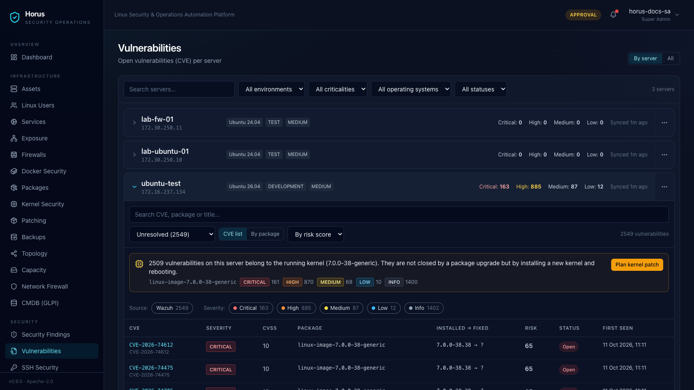<br><sub><b>Vulnerabilities & findings</b> - by server and package, kernel patch flow</sub></td>
    <td align="center">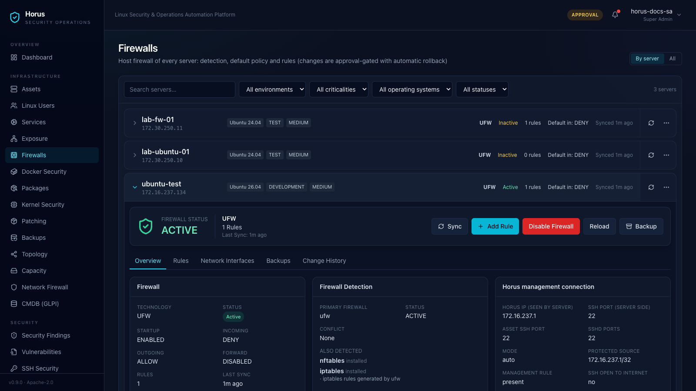<br><sub><b>Firewall management</b> - dry run, approval and auto-rollback</sub></td>
  </tr>
  <tr>
    <td align="center">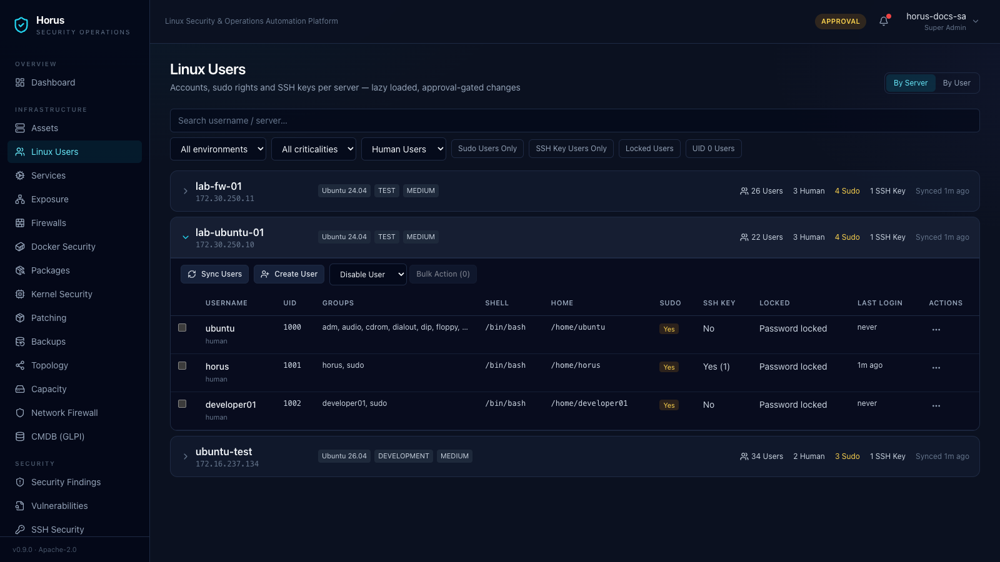<br><sub><b>Linux users</b> - accounts, sudo rights and SSH keys</sub></td>
    <td align="center">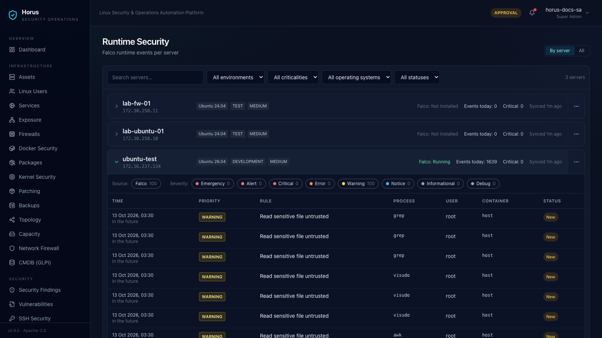<br><sub><b>Runtime security</b> - Falco events and incidents</sub></td>
  </tr>
  <tr>
    <td align="center">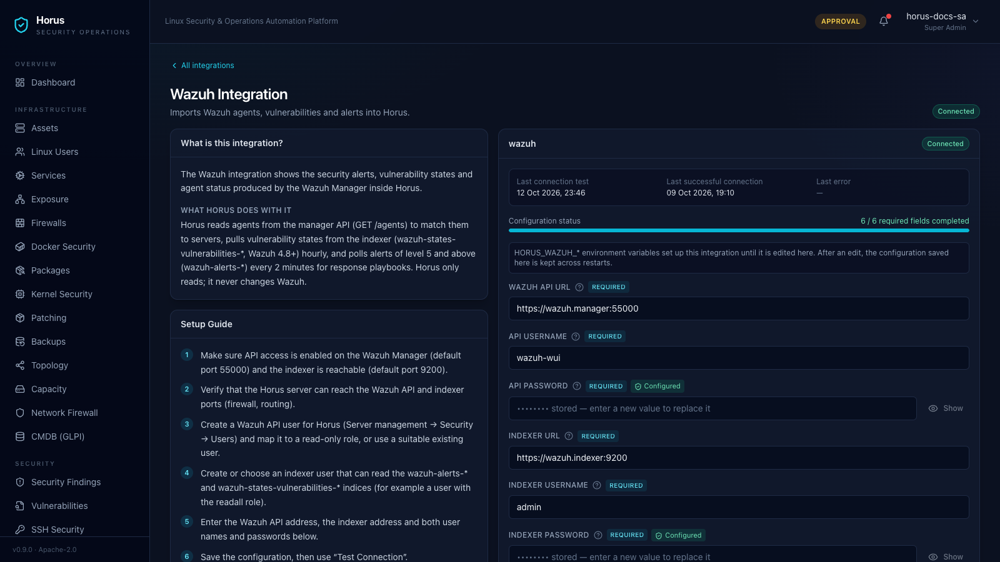<br><sub><b>Wazuh integration</b> - connection test and synchronisation</sub></td>
    <td align="center">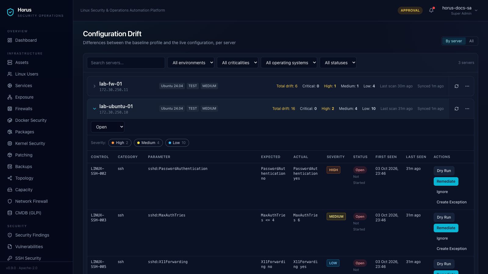<br><sub><b>Configuration & capacity drift</b></sub></td>
  </tr>
  <tr>
    <td align="center">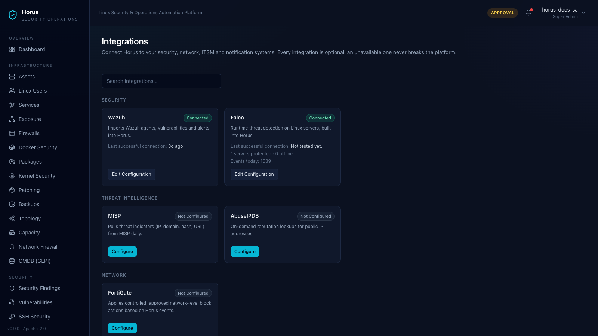<br><sub><b>Settings & integrations</b></sub></td>
    <td align="center">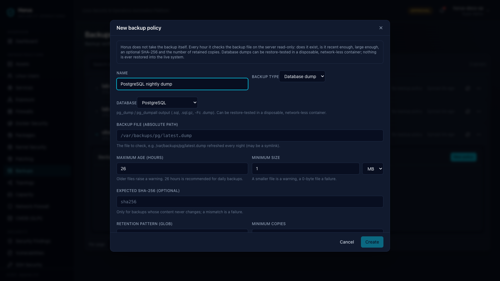<br><sub><b>Backups</b> - verification policies and restore tests</sub></td>
  </tr>
  <tr>
    <td align="center" colspan="2">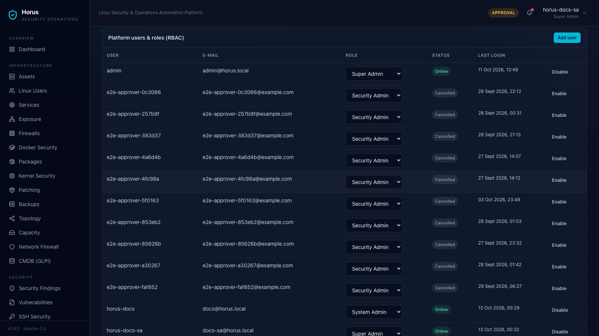<br><sub><b>Users & roles</b> - role-based access control</sub></td>
  </tr>
</table>

---

## Troubleshooting

<details>
<summary><b>Docker is not running / "Cannot connect to the Docker daemon"</b></summary>

Linux: `sudo systemctl enable --now docker`, and make sure your user is in the `docker` group (log out and in after
`usermod -aG docker`). macOS / Windows: start Docker Desktop and wait until it reports *running*.
</details>

<details>
<summary><b>"docker compose >= 2.24 required"</b></summary>

Update the Compose plugin (`sudo apt-get install docker-compose-plugin`) or Docker Desktop. Check with
`docker compose version`.
</details>

<details>
<summary><b>Port 80 or 443 is already in use</b></summary>

Find the process (`sudo ss -ltnp | grep -E ':(80|443) '`), stop it, or set `HORUS_HTTPS_PORT` / `HORUS_HTTP_PORT` in
`.env` (for example `8443` / `8080`) and open `https://<HORUS_DOMAIN>:8443/`.
</details>

<details>
<summary><b>"Permission denied" when running a script</b></summary>

Run `chmod +x scripts/*.sh`. On Windows, make sure the repository was cloned **inside WSL** (not `/mnt/c`).
</details>

<details>
<summary><b>"/bin/sh^M: bad interpreter"</b></summary>

The scripts have Windows line endings - the repository was cloned with Git for Windows. Delete it and clone again
from the WSL terminal.
</details>

<details>
<summary><b>".env missing" / "HORUS_IMAGE is not set" / "HORUS_ADMIN_PASSWORD is required"</b></summary>

Create `.env` from `.env.example` and set `HORUS_IMAGE`, `HORUS_VERSION`, `HORUS_DOMAIN` and, for a new
installation, `HORUS_ADMIN_PASSWORD`.
</details>

<details>
<summary><b>Signature verification failed / "HORUS_SIGNING_IDENTITY is not set"</b></summary>

When `cosign` is installed, the installer verifies the images and stops on any problem - by design. Copy
`backend.digest`, `frontend.digest` and `signature.identity` from `release-manifest.json` into `.env` exactly, and
make sure `HORUS_VERSION` matches the manifest. Never edit the identity. If it still fails, do not install - the
images may not be the ones that were released.
</details>

<details>
<summary><b>Images cannot be pulled ("pull access denied", "manifest unknown")</b></summary>

Check `HORUS_IMAGE` and `HORUS_VERSION` (tags are `backend-<version>` / `frontend-<version>`), network access to
Docker Hub, and run `docker login` if the repository is private. Docker Hub rate limits for anonymous pulls can also
cause temporary failures - logging in raises the limit.
</details>

<details>
<summary><b>Windows: Docker Desktop is in Windows containers mode / WSL2 not installed</b></summary>

Right-click the Docker tray icon → *Switch to Linux containers*. Install WSL2 with `wsl --install -d Ubuntu`
(PowerShell as Administrator), enable *Use the WSL 2 based engine* and the WSL integration for Ubuntu in Docker
Desktop settings.
</details>

<details>
<summary><b>Browser certificate warning</b></summary>

Expected with `--self-signed`. Install a CA-issued certificate in `nginx/certs/` and run
`docker compose restart nginx`.
</details>

<details>
<summary><b>A service is unhealthy</b></summary>

`docker compose ps` shows which one; `docker compose logs --tail 200 <service>` shows why. Common causes: a weak
`HORUS_ADMIN_PASSWORD` (the `api` refuses to start), `HORUS_WORKER_CPUS` higher than the host's CPUs, not enough
memory, or a full disk.
</details>

<details>
<summary><b>The bundled Wazuh does not start</b></summary>

Wazuh needs x86_64, `vm.max_map_count=262144`, about 8 GB of extra memory, the three `WAZUH_*_PASSWORD` values in
`.env` and `./scripts/wazuh-init.sh` run once. Check `docker compose -f docker-compose.wazuh.yml logs wazuh-indexer`.
</details>

<details>
<summary><b>Problems after an update or restore</b></summary>

Run `./scripts/verify.sh` and check `docker compose logs api`. After an update, `./scripts/rollback.sh` returns to the
previous release (`--with-backup` if the schema changed). A restore keeps the previous database as
`horus_pre_restore_<timestamp>` until you drop it.
</details>

More: [docs/en/troubleshooting.md](docs/en/troubleshooting.md).

---

## FAQ

**Which systems does Horus run on?**
Any 64-bit Linux host with Docker (x86_64 or ARM64), plus macOS and Windows 10/11 via Docker Desktop for
evaluation. See the [support matrix](#support-matrix).

**Do I download the images manually?**
No. `install.sh` and `update.sh` pull them from Docker Hub with `docker compose pull`.

**Does Docker pick the right architecture?**
Yes. Each tag is a multi-architecture image; Docker selects `linux/amd64` or `linux/arm64` for your host.

**Does Horus run on Windows?**
Yes, through Docker Desktop with WSL2 and Linux containers, with the scripts run inside WSL. Native Windows
containers are not supported.

**What does a public Docker Hub image mean?**
Anyone can pull it without an account. It contains the compiled application, not its source code, and its
integrity is guaranteed by signatures - not by secrecy.

**What is the difference between this repository and the source repository?**
This public repository contains only deployment files (Compose, configuration, scripts, documentation). The
application source code is kept in a separate, private repository and is never needed to run Horus.

**Why might I not need `docker login`?**
Pulling from a public repository needs no account. You only need to log in if your images are in a private
repository, or to raise Docker Hub's anonymous pull rate limit.

**Why WSL2 on Windows?**
Horus images are Linux containers, and the scripts are POSIX shell scripts that depend on Linux file permissions.
WSL2 provides both and is the backend Docker Desktop uses for Linux containers.

**What do you recommend for production?**
A dedicated Ubuntu LTS or Debian 12 x86_64 VM, a CA-issued certificate, digest-pinned images with
`--require-signature`, regular encrypted off-host backups, and `APPROVAL` mode with four-eyes approvals.

---

## Repository layout

```text
horus-deploy/
├── docker-compose.yml          # Horus stack: images, networks, volumes, hardening
├── docker-compose.wazuh.yml    # optional: Horus + bundled single-node Wazuh
├── .env.example                # configuration template (copy to .env)
├── release-manifest.json       # per release: digests, signing identity, SBOMs, agent checksums
├── RELEASE_NOTES.md, VERSION   # per release
├── SECURITY.md, SECURITY.tr.md # security guarantees and responsibilities (English / Turkish)
├── scripts/                    # install, update, rollback, backup, restore, verify, ...
├── policies/                   # your policy overrides (examples/ is never loaded)
├── nginx/                      # reverse proxy: https and http-dev sites, certs/
├── monitoring/                 # Prometheus, Loki and Grafana provisioning
├── falco/                      # optional Falco on the Docker host
├── wazuh/                      # optional bundled Wazuh configuration
├── README.md, README.tr.md    # this README in English / Turkish
└── docs/                       # guides: en/ (English), tr/ (Turkish), images/
```

---

## Next steps

After the installation:

1. ✅ **Sign in** as `admin` and set a new password.
2. 👥 **Create personal accounts** with the right roles and remove `HORUS_ADMIN_PASSWORD` from `.env`.
3. 🔌 **Configure integrations** - Wazuh, notifications, threat intelligence ([docs/en/integrations.md](docs/en/integrations.md)).
4. 🖥️ **Add your first server** under **Assets** (SSH address, user and key) and run discovery and a security scan.
5. 📋 **Review the policies** - operation mode, approvals, baselines; put overrides into [`policies/`](policies/README.md).
6. 💾 **Take a backup** - `./scripts/backup.sh` - and store it off-host, encrypted.
7. 🔍 **Run** `./scripts/verify.sh` after every change to the deployment.

