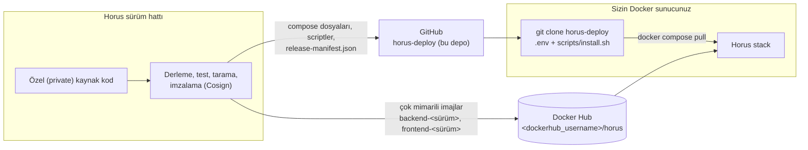
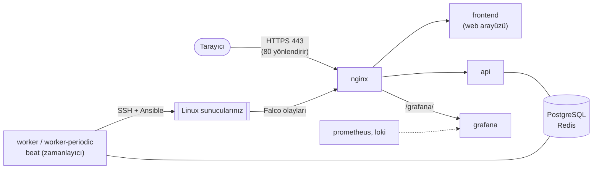

<p align="center"><a href="README.md">English</a> | <b>Türkçe</b></p>

<p align="center">
  
</p>

<p align="center">
  
  
  
  
</p>

<p align="center">
  <b>Horus dağıtım (deployment) deposu</b> - Horus'u önceden derlenmiş, imzalı container imajlarından kurmak,
  güncellemek, yedeklemek ve geri yüklemek için gereken her şey. <b>Kaynak kod gerekmez ve bu depoda yer almaz.</b>
</p>

---

## İçindekiler

- [Horus nedir?](#horus-nedir)
- [Yetenekler](#yetenekler)
- [Mimari](#mimari)
- [Destek matrisi](#destek-matrisi)
- [Hızlı başlangıç](#hızlı-başlangıç)
- [Ön koşullar](#ön-koşullar)
- [Kurulum: işletim sistemine göre](#kurulum-işletim-sistemine-göre)
- [Ayrıntılı kurulum rehberi](#ayrıntılı-kurulum-rehberi)
- [Scriptler](#scriptler)
- [Horus'u güncelleme](#horusu-güncelleme)
- [Yedekleme, geri yükleme ve geri alma](#yedekleme-geri-yükleme-ve-geri-alma)
- [Doğrulama ve sağlık kontrolleri](#doğrulama-ve-sağlık-kontrolleri)
- [Güvenlik notları](#güvenlik-notları)
- [Ekran görüntüleri](#ekran-görüntüleri)
- [Sorun giderme](#sorun-giderme)
- [SSS](#sss)
- [Repo yapısı](#repo-yapısı)
- [Sonraki adımlar](#sonraki-adımlar)

---

## Horus nedir?

**Horus, Linux sunucu filoları için kendi altyapınızda çalışan (self-hosted) bir güvenlik ve operasyon
platformudur.** Sistem ve güvenlik ekiplerine her sunucunun güvenlik durumunu tek bir yerden görme, sorunları
bulma ve bunları kontrollü, denetlenebilir biçimde düzeltme imkânı verir. Bunu yalnızca SSH ile yapar; sunuculara
herhangi bir yazılım kurulması gerekmez.

**Çözdüğü problem.** Çoğu ortamda Linux sunucuların güvenlik durumu birçok araca dağılmıştır: zafiyet tarayıcıları,
SIEM alarmları, kullanıcı ve sudo yetkilerini tutan tablolar, elle düzenlenen firewall kuralları ve tek seferlik
scriptler. Değişiklikleri gözden geçirmek zor, geri almak ise daha da zordur. Horus envanteri, bulguları, olayları ve
düzeltme işlemlerini bir araya getirir; her değişikliği dry run (deneme çalıştırması), onay, doğrulama ve geri alma
adımlarından geçirir.

**Teknik olarak** Horus, PostgreSQL ve Redis üzerinde çalışan, container tabanlı bir web uygulamasıdır (API, arka
plan worker'ları, zamanlayıcı ve web arayüzü). Yönetilen sunuculara SSH ile bağlanır ve sıkılaştırılmış, izin
listesine alınmış Ansible playbook'ları çalıştırır. Zafiyetler ve alarmlar için **Wazuh**, çalışma zamanı güvenlik
olayları için **Falco** ile entegre olur.

**Kimler için?**

| Hedef kitle | Tipik kullanım |
|---|---|
| Sistem yöneticileri | Envanter, paketler ve yama yönetimi, Linux kullanıcıları, servisler, firewall kuralları |
| Güvenlik ekipleri / SOC | Bulgular, zafiyetler, çalışma zamanı olayları, olay yönetimi (incident), tehdit avcılığı |
| DevOps / SRE | Yapılandırma ve kapasite sapması, servisler ve SLO'lar, değişiklik ve bakım pencereleri |
| BT / uyumluluk ekipleri | Baseline ve uyumluluk raporları, denetim izi, erişim gözden geçirmeleri, yedek doğrulama |

---

## Yetenekler

<table>
<tr><td width="50%" valign="top">

**Filo ve varlık (asset) yönetimi**
- SSH ile keşfedilen Linux sunucu envanteri (işletim sistemi, kernel, CPU, bellek, diskler, servisler, açık portlar)
- İlk bağlantıda sabitlenen host anahtarları; tek bir dinamik envanter - statik envanter dosyası yok
- Salt okunur telemetri için isteğe bağlı hafif ajan

**Güvenlik görünürlüğü**
- Sunucu bazında ve filo genelinde güvenlik skoru
- Baseline'lara ve uyumluluk çerçevelerine eşlenmiş güvenlik bulguları
- SSH yapılandırması, sudo yetkileri, kernel ve sysctl sıkılaştırması, ağ erişimi (exposure), sertifikalar, dosya
  bütünlüğü

**Zafiyet yönetimi**
- **Wazuh**'tan zafiyet aktarımı; sunucu ve pakete göre gruplanmış görünüm
- Kontrollü paket yamalama ve rehberli **kernel yaması** akışı (kurulum, yeniden başlatma, doğrulama, temizlik)

**Çalışma zamanı güvenliği**
- Sunucu bazında **Falco** olaylarının alınması; önceliklendirme (triage), korelasyon ve olay (incident) oluşturma
- Docker sunucusunun kendisi için isteğe bağlı Falco

</td><td width="50%" valign="top">

**Kontrollü otomasyon**
- **Dry run, onay, doğrulama ve geri alma** içeren SSH + Ansible tabanlı düzeltme
- Çalışma modları: gözlem, onay gerekli, otonom; production için dört göz (four-eyes) onayı
- **Firewall kural yönetimi** (ufw, firewalld, nftables, iptables) ve commit-confirm ile otomatik geri alma
- **Linux kullanıcı yönetimi**: kullanıcılar, SSH anahtarları, sudo, tam zamanında (just-in-time) erişim, break glass

**Operasyon**
- Paket ve güncelleme görünürlüğü, paket deposu (repository) yönetimi
- **Yapılandırma sapması (Configuration Drift)** ve **kapasite** takibi
- Yedek doğrulama politikaları ve veritabanı geri yükleme testleri
- İşler (jobs), değişiklik ve bakım pencereleri, runbook'lar

**Yönetişim**
- Önceden tanımlı rollerle **rol tabanlı erişim kontrolü (RBAC)**
- Girişlerin, değişikliklerin ve onayların eksiksiz **denetim izi (audit trail)**
- Politika tabanlı skorlama, baseline'lar ve uyumluluk görünümleri

</td></tr>
</table>

**Dağıtım ve bütünlük**
- Çok mimarili (multi-architecture) imajlar (**linux/amd64** ve **linux/arm64**) - Docker doğru olanı otomatik seçer
- İmajlar **Docker Hub**'da, dağıtım dosyaları **bu depoda** yayımlanır
- Her sürüm imajı **Cosign ile imzalanır**; scriptler herhangi bir şeyi başlatmadan önce imzaları ve digest'leri
  doğrular
- Script tabanlı ve doğrulamalı **kurulum, güncelleme, yedekleme, geri yükleme ve geri alma**

**Bugün kullanılabilen entegrasyonlar:** Wazuh (zafiyetler ve alarmlar), Falco (çalışma zamanı olayları), Slack,
Microsoft Teams, genel webhook'lar, e-posta (SMTP), MISP ve AbuseIPDB (tehdit istihbaratı), GLPI (CMDB ve kayıtlar),
FortiGate (ağ firewall'u) ve HashiCorp Vault (secret backend). Entegrasyonlar web arayüzünden yapılandırılır; gizli
bilgileri şifreli olarak saklanır.

---

## Mimari

Horus **bilinçli olarak birbirinden ayrı tutulan iki parça** halinde dağıtılır:

1. Docker Hub'daki **container imajları** - Horus sürüm (release) hattı tarafından derlenip imzalanan uygulamanın
   kendisi.
2. **Bu dağıtım deposu** - klonlayıp çalıştırdığınız Compose dosyaları, yapılandırma şablonları ve operasyon
   scriptleri. Uygulamanın kaynak kodunu içermez.



**Çalışma zamanı topolojisi** - dışarıdan yalnızca nginx'e erişilebilir; geri kalan her şey iç Docker ağlarında
kalır:



| Bileşen | İmaj | Görev |
|---|---|---|
| `api`, `worker`, `worker-periodic`, `beat` | `<dockerhub_username>/horus:backend-<version>` | Tek bir backend imajı; servisler yalnızca çalıştırdıkları komutla ayrılır |
| `frontend` | `<dockerhub_username>/horus:frontend-<version>` | Web arayüzü |
| `nginx`, `postgres`, `redis`, `prometheus`, `loki`, `grafana` | Resmi upstream imajlar, sabitlenmiş sürümler | Ters vekil sunucu (reverse proxy), veri, izleme |
| `horus-init` | `alpine` | Tek seferlik: eksik secret'ları `horus_secrets` volume'una üretir |
| `falco` *(isteğe bağlı profil)* | `falcosecurity/falco` | Docker sunucusunun çalışma zamanı güvenliği |
| Wazuh stack'i *(isteğe bağlı dosya)* | `wazuh/wazuh-*` | Paketli tek düğümlü Wazuh (`docker-compose.wazuh.yml`) |

---

## Destek matrisi

| Platform | Durum | Notlar |
|---|---|---|
| **Ubuntu / Debian, x86_64** | ✅ Production için önerilen | Docker Engine; paketli Wazuh dahil tüm bileşenler desteklenir |
| **Linux, ARM64** (ör. Graviton, Ampere) | ✅ Desteklenir | Native arm64 imajlar; **paketli Wazuh stack'i yalnızca x86_64** |
| **macOS, Intel** | ✅ Değerlendirme / geliştirme | Docker Desktop |
| **macOS, Apple Silicon** | ✅ Değerlendirme / geliştirme | Docker Desktop; arm64 imajlar otomatik seçilir |
| **Windows 10 / 11 (x86_64)** | ✅ Değerlendirme / geliştirme | Docker Desktop + **WSL2**, Linux containers modu; scriptler WSL içinde çalıştırılır |
| **ARM tabanlı Windows** | ⚠️ En iyi çaba (best effort), test edilmedi | Windows on ARM için Docker Desktop + WSL2 (arm64 imajlar) |
| **Native Windows container'ları** | ❌ Desteklenmez | Horus imajları Linux container'larıdır |

| Gereksinim | Asgari |
|---|---|
| Docker | Docker Engine 24+ (Linux) veya güncel bir Docker Desktop (macOS / Windows) |
| Docker Compose | **v2.24 veya üstü** (`docker compose version`) - scriptler tarafından kontrol edilir |
| Kabuk araçları | POSIX `sh`, `git`, `openssl`, `curl`, `awk` (Linux ve macOS'ta yüklü gelir, WSL'de mevcuttur) |

> [!TIP]
> **Önerilen production kurulumu:** 4+ vCPU, 8+ GB RAM (paketli Wazuh ile 16 GB), 50+ GB SSD, bir DNS adı ve bir
> sertifika otoritesi (CA) tarafından imzalanmış TLS sertifikasına sahip, Horus'a ayrılmış bir Ubuntu 22.04/24.04 LTS
> veya Debian 12 x86_64 sanal makine.

---

## Hızlı başlangıç

> [!NOTE]
> Bu, çalışan bir kuruluma giden en kısa yoldur. Production'a geçmeden önce [Ön koşullar](#ön-koşullar) ve
> [Ayrıntılı kurulum rehberi](#ayrıntılı-kurulum-rehberi) bölümlerini okuyun.

```bash
# 1. Dağıtım dosyalarını alın (çalıştırmak istediğiniz sürümün tag'ini kullanın)
git clone --branch v1.0.0 https://github.com/doganyesilkir/horus-deploy.git
cd horus-deploy

# 2. Yapılandırmanızı oluşturun
cp .env.example .env
chmod 600 .env
${EDITOR:-nano} .env        # en azından HORUS_DOMAIN ve HORUS_ADMIN_PASSWORD değerlerini girin (aşağıya bakın)

# 3. Kurun - imajları çeker, stack'i başlatır ve doğrular
./scripts/install.sh --self-signed     # nginx/certs/ altında sertifikanız varsa --self-signed olmadan
```

Ardından `https://<HORUS_DOMAIN>/` adresini açın, `admin` kullanıcısı ve `HORUS_ADMIN_PASSWORD` ile giriş yapın ve
yeni bir parola belirleyin.

**Otomatik olarak gerçekleşenler**

- **İmajlar Docker Hub'dan çekilir.** `install.sh` `docker compose pull` çalıştırır; imajları hiçbir zaman elle
  indirmezsiniz. Docker, sunucunuza uyan `linux/amd64` veya `linux/arm64` varyantını seçer.
- **Secret'lar üretilir.** `.env` içinde boş bırakılan her secret (veritabanı, Redis, JWT, ana anahtar …)
  `horus_secrets` Docker volume'unda bir kez oluşturulur.
- **`cosign` yüklüyse imzalar doğrulanır.** Kurulum scripti iki imajı da sürümün imza kimliğine (signing identity)
  karşı kontrol eder ve doğrulama başarısız olursa **kurulumu reddeder**. `cosign` yüklü olmasa bile doğrulamayı
  zorunlu kılmak için `--require-signature` kullanın.
- **Sonuç kontrol edilir.** Kurulum scripti her sağlık kontrolünü (health check) bekler ve `scripts/verify.sh`'i
  çalıştırır (HTTPS, HSTS, yönlendirmeler, container sıkılaştırması).

> [!IMPORTANT]
> Bir **sürüm checkout'unda** (`git clone --branch vX.Y.Z`), `.env.example` o sürümün imaj adını, sürümünü, imaj
> digest'lerini ve imza kimliğini `release-manifest.json`'dan alınmış olarak zaten içerir. Başka bir dal (branch)
> ile başlıyorsanız `HORUS_IMAGE` ve `HORUS_VERSION` değerlerini kendiniz girin
> (bkz. [`.env` dosyasını yapılandırın](#2-env-dosyasını-yapılandırın)).

---

## Ön koşullar

### Docker

- **Linux:** Compose eklentisi v2.24+ ile Docker Engine 24+.
- **macOS / Windows:** Docker Desktop (Compose v2 dahildir). Windows'ta WSL2 ve **Linux containers** modu
  zorunludur.
- Horus **yalnızca Linux container'ları** çalıştırır.

### Kaynaklar

| Kaynak | Asgari | Önerilen | Paketli Wazuh ile |
|---|---|---|---|
| CPU | 2 çekirdek | 4 çekirdek | 6+ çekirdek |
| Bellek | 6 GB | 8 GB | 16 GB |
| Disk | 20 GB boş | 50 GB SSD | 100 GB SSD |

Kurulum scripti, dağıtım dizininde 5 GB'tan az boş alan varsa uyarır. `.env` içindeki `HORUS_WORKER_CPUS`
(varsayılan `2.0`), sunucudaki CPU sayısını aşmamalıdır.

### Ağ ve portlar

| Port (sunucu) | Amaç | Değişken |
|---|---|---|
| `443/tcp` | Horus web arayüzü ve API (HTTPS) | `HORUS_HTTPS_PORT` |
| `80/tcp` | HTTPS'e yönlendirme (`https` modu) veya düz HTTP (`http-dev` modu) | `HORUS_HTTP_PORT` |
| `1514/tcp`, `1515/tcp` | Wazuh ajanları - yalnızca paketli Wazuh | - |
| `127.0.0.1:8443` | Wazuh dashboard'u - yalnızca paketli Wazuh, varsayılan olarak loopback | `WAZUH_DASHBOARD_BIND`, `WAZUH_DASHBOARD_PORT` |

Giden bağlantılar: Docker sunucusundan Horus'un yöneteceği sunuculara SSH (`22/tcp` veya kullandığınız SSH portu) ve
imajları çekmek için Docker Hub'a HTTPS. PostgreSQL, Redis, API, Prometheus ve Loki sunucu üzerinde **asla**
yayımlanmaz (publish edilmez).

### DNS ve TLS

- Horus'a bir DNS adı verin (örneğin `horus.example.com`) ve bunu `HORUS_DOMAIN` olarak ayarlayın.
- **Production:** CA tarafından imzalanmış sertifikayı `nginx/certs/fullchain.pem` ve `nginx/certs/privkey.pem`
  dosyalarına koyun.
- **Değerlendirme:** `./scripts/install.sh --self-signed`, `HORUS_DOMAIN` için geçici, kendinden imzalı
  (self-signed) bir sertifika oluşturur (tarayıcılar uyarı gösterir). Production kullanımından önce gerçek bir
  sertifikayla değiştirin.

### Docker Hub imaj erişimi

Horus imajları `HORUS_IMAGE` değişkeninde belirtilen Docker Hub deposundan (`<dockerhub_username>/horus`) çekilir.
Depo **public** ise giriş yapmanız gerekmez. Size **private** bir depoya erişim verildiyse kurulumdan önce
aldığınız bilgilerle `docker login` çalıştırın.

### Wazuh (isteğe bağlı)

- **Harici Wazuh:** Docker sunucusunda ek bir şey gerekmez - bağlantıyı `.env` içinde veya arayüzde yapılandırın.
- **Paketli Wazuh** (`docker-compose.wazuh.yml`): yalnızca x86_64 Linux, +8 GB RAM ve sunucuda:

  ```bash
  sudo sysctl -w vm.max_map_count=262144
  echo 'vm.max_map_count=262144' | sudo tee /etc/sysctl.d/99-wazuh.conf
  ```

---

## Kurulum: işletim sistemine göre

Aşağıdaki her bölüm, kopyalayıp yapıştırabileceğiniz eksiksiz bir yoldur. Beklenen çıktılarla birlikte daha uzun,
adım adım rehberler [`docs/tr/`](docs/tr/) altındadır.

### Ubuntu / Debian Linux

```bash
# Docker'ın resmi deposundan Docker Engine + Compose eklentisi (Ubuntu; Debian için "ubuntu" yerine "debian" yazın)
sudo apt-get update
sudo apt-get install -y ca-certificates curl git openssl
sudo install -m 0755 -d /etc/apt/keyrings
sudo curl -fsSL https://download.docker.com/linux/ubuntu/gpg -o /etc/apt/keyrings/docker.asc
sudo chmod a+r /etc/apt/keyrings/docker.asc
echo "deb [arch=$(dpkg --print-architecture) signed-by=/etc/apt/keyrings/docker.asc] https://download.docker.com/linux/ubuntu $(. /etc/os-release && echo "$VERSION_CODENAME") stable" \
  | sudo tee /etc/apt/sources.list.d/docker.list > /dev/null
sudo apt-get update
sudo apt-get install -y docker-ce docker-ce-cli containerd.io docker-buildx-plugin docker-compose-plugin
sudo usermod -aG docker "$USER"      # ardından oturumu kapatıp yeniden açın

# Horus
git clone --branch v1.0.0 https://github.com/doganyesilkir/horus-deploy.git && cd horus-deploy
cp .env.example .env && chmod 600 .env && nano .env
./scripts/install.sh --self-signed   # veya: sertifikanızı nginx/certs/ altına koyup ./scripts/install.sh çalıştırın

# Kontrol
docker compose ps
./scripts/verify.sh
```

`https://<HORUS_DOMAIN>/` adresini açın. Tam rehber: [docs/tr/installation-linux.md](docs/tr/installation-linux.md).

### Linux ARM64

Horus imajları **çok mimarilidir**: aynı tag bir `linux/amd64` ve bir `linux/arm64` imajı içerir ve Docker
işlemcinize uyanı otomatik olarak çeker:

```text
<dockerhub_username>/horus:backend-X.Y.Z
├── linux/amd64   → Intel / AMD sunucular
└── linux/arm64   → ARM sunucular (Graviton, Ampere, Apple Silicon, …)
```

Mimari seçmeniz gerekmez. Adımlar yukarıdaki Ubuntu / Debian bölümüyle aynıdır.

> [!WARNING]
> **Paketli Wazuh stack'i** (`docker-compose.wazuh.yml`) yalnızca x86_64 üzerinde çalışır. ARM64'te Horus'u başka bir
> yerde çalışan bir Wazuh sunucusuna bağlayın.

### macOS (Intel)

1. [Docker Desktop for Mac](https://docs.docker.com/desktop/setup/install/mac-install/) kurun ve başlatın.
2. *Settings → Resources* bölümünde Docker'a en az **4 CPU ve 8 GB bellek** verin.
3. Terminal'de:

```bash
git clone --branch v1.0.0 https://github.com/doganyesilkir/horus-deploy.git ~/horus-deploy && cd ~/horus-deploy
cp .env.example .env && chmod 600 .env && open -e .env      # HORUS_DOMAIN=localhost ve HORUS_ADMIN_PASSWORD girin
./scripts/install.sh --self-signed
```

`https://localhost/` adresini açın. Docker Desktop Intel Mac'te `linux/amd64` imajlarını çeker. Tam rehber:
[docs/tr/installation-macos.md](docs/tr/installation-macos.md).

### macOS (Apple Silicon)

Adımlar macOS Intel ile aynıdır. Docker Desktop **arm64** (`linux/arm64`) imajlarını otomatik olarak çeker - Rosetta
ve ek parametre gerekmez.

> [!NOTE]
> macOS'te Horus'u değerlendirme ve geliştirme amacıyla kullanın. İsteğe bağlı **Falco** profili Linux sunucu
> kernel'i gerektirir ve **paketli Wazuh** stack'i yalnızca x86_64 üzerinde çalışır; bu nedenle ikisi de Mac'te
> Docker Desktop altında çalışmaz.

### Windows 10 / 11

Horus, Windows'ta **WSL2 altyapılı Docker Desktop** ile çalışır. Tüm komutları PowerShell'de değil, **bir WSL Linux
dağıtımı (ör. Ubuntu) içinde** çalıştırın: scriptler, Linux dosya izinlerine ve Unix satır sonlarına ihtiyaç duyan
POSIX kabuk scriptleridir.

```powershell
# PowerShell (Yönetici olarak) - bir kez
wsl --install -d Ubuntu
```

1. [Docker Desktop for Windows](https://docs.docker.com/desktop/setup/install/windows-install/) kurun,
   **Use the WSL 2 based engine** seçeneğini etkinleştirin ve **Linux containers** modunda bırakın (varsayılan).
2. *Settings → Resources → WSL integration* bölümünde **Ubuntu** için entegrasyonu etkinleştirin.
3. **Ubuntu** terminalini açın ve çalıştırın:

```bash
cd ~                                   # WSL dosya sistemi içinde - /mnt/c/... değil
git clone --branch v1.0.0 https://github.com/doganyesilkir/horus-deploy.git && cd horus-deploy
cp .env.example .env && chmod 600 .env && nano .env     # HORUS_DOMAIN=localhost, HORUS_ADMIN_PASSWORD=...
./scripts/install.sh --self-signed
```

Windows tarayıcınızda `https://localhost/` adresini açın. Tam rehber:
[docs/tr/installation-windows.md](docs/tr/installation-windows.md).

> [!CAUTION]
> Depoyu `C:\...` veya `/mnt/c/...` altına klonlamayın ve Git for Windows ile klonlamayın: orada `chmod` etkisizdir
> ve CRLF satır sonları kabuk scriptlerini bozar (`/bin/sh^M: bad interpreter`).

### Windows on ARM (ARM tabanlı Windows)

WSL2 ile birlikte Windows on ARM için Docker Desktop, **arm64** Horus imajlarını kullanır; kurulum adımları Windows
10 / 11 ile aynıdır. Bu kombinasyon Horus sürüm hattında **test edilmez** - yalnızca değerlendirme için kullanın.

---

## Ayrıntılı kurulum rehberi

### 1. Dağıtım deposunu klonlayın

```bash
git clone --branch v1.0.0 https://github.com/doganyesilkir/horus-deploy.git
cd horus-deploy
```

Horus'un her sürümü bu depoda bir tag'dir. Bir sürüm checkout'u şunları içerir:

| Dosya | Amaç |
|---|---|
| `release-manifest.json` | Sürümün kesin imaj referansları (depo, tag, **sha256 digest'leri**, platformlar), **imza kimliği**, SBOM dosya adları ve ajan sağlama toplamları (checksum) |
| `.env.example` | Sürümün imajı, sürüm numarası, digest'leri ve imza kimliğiyle önceden doldurulmuş yapılandırma şablonu |
| `RELEASE_NOTES.md`, `VERSION` | Değişenler, migration ve geri alma notları |

### 2. `.env` dosyasını yapılandırın

```bash
cp .env.example .env
chmod 600 .env
```

`.env` yapılandırmanızı ve muhtemelen secret'ları tutar - git tarafından yok sayılır ve yalnızca yöneticiler
tarafından okunabilir kalmalıdır. En önemli ayarlar:

| Değişken | Zorunlu | Açıklama |
|---|---|---|
| `HORUS_IMAGE` | ✅ | İmaj deposu, `<dockerhub_username>/horus` (tag olmadan) |
| `HORUS_VERSION` | ✅ | Kesin sürüm, ör. `1.0.0`. Kullanılan imajlar: `backend-<version>` ve `frontend-<version>`. `latest` reddedilir |
| `HORUS_BACKEND_DIGEST`, `HORUS_FRONTEND_DIGEST` | Önerilir | `release-manifest.json`'daki `sha256:` digest'leri - kesin imajları sabitler; **imza doğrulaması için zorunludur** |
| `HORUS_SIGNING_IDENTITY` | Önerilir | `release-manifest.json`'daki `signature.identity`, birebir kopyalanır |
| `HORUS_DOMAIN` | ✅ | Kullanıcıların açtığı DNS adı (kendinden imzalı sertifika için de kullanılır) |
| `HORUS_ADMIN_PASSWORD` | ✅ yeni kurulumlarda | İlk yönetici parolası - güçlü ve benzersiz olmalı; zayıf değerler reddedilir |
| `HORUS_PROXY_MODE` | | `https` (varsayılan) veya `http-dev` (düz HTTP, yalnızca geliştirme) |
| `HORUS_HTTPS_PORT`, `HORUS_HTTP_PORT`, `HORUS_BIND_ADDRESS` | | nginx'in yayımladığı portlar ve dinlediği adres |
| `HORUS_OPERATION_MODE` | | `OBSERVE`, `APPROVAL` (varsayılan) veya `AUTONOMOUS` |
| `HORUS_ALLOW_SELF_APPROVAL` | | Tek yöneticili kurulumlar için `true`, dört göz prensibi için `false` |
| `HORUS_WORKER_CPUS` | | Otomasyon worker'ının CPU sınırı - sunucunun CPU sayısını aşmamalıdır |
| `HORUS_IP_WHITELIST` | | Otomasyonun asla engellememesi gereken IP/CIDR'ler (yönetim ağlarınızı ekleyin) |

Wazuh, Vault ve parola politikası ayarları dahil tam referans:
[docs/tr/configuration.md](docs/tr/configuration.md).

**Değerleri `release-manifest.json`'dan alma** (bir sürüm checkout'unda bu sizin için zaten yapılmıştır):

```bash
jq -r '.backend.digest, .frontend.digest, .signature.identity' release-manifest.json
```

**Secret'lar.** `HORUS_MASTER_KEY`, `HORUS_JWT_SECRET`, `POSTGRES_PASSWORD`, `REDIS_PASSWORD`,
`GRAFANA_ADMIN_PASSWORD` ve `HORUS_INGEST_TOKEN` değerlerini boş bırakırsanız `horus_secrets` volume'una bir kez
üretilirler; dilerseniz kendi değerlerinizi verin (örneğin `openssl rand -hex 32` ile).

> [!WARNING]
> **Ana anahtar (master key)** saklanan SSH anahtarlarını ve entegrasyon secret'larını şifreler. Kaybolursa bunlar
> kurtarılamaz. `scripts/backup.sh` ile yedekleyin (arşiv secrets volume'unu içerir) veya değeri kendiniz yönetin.

### 3. TLS sertifikası

```bash
# production: sertifikanızı ve anahtarınızı kopyalayın
cp /path/to/fullchain.pem nginx/certs/fullchain.pem
cp /path/to/privkey.pem   nginx/certs/privkey.pem
chmod 0644 nginx/certs/fullchain.pem && chmod 0640 nginx/certs/privkey.pem
```

Sertifikanız yoksa geçici, kendinden imzalı bir sertifika için `./scripts/install.sh --self-signed` kullanın.

### 4. Kurulum

```bash
./scripts/install.sh                      # nginx/certs/ altında sertifika var
./scripts/install.sh --self-signed        # geçici kendinden imzalı sertifika
./scripts/install.sh --require-signature  # cosign iki imajı da doğrulamazsa kurulumu reddet
```

`install.sh` sırasıyla şunları yapar:

1. **Ön kontrol (preflight)** - Docker ve Compose sürümleri, `.env` dosyasının varlığı ve `chmod 600`, imaj ayarları
   (`latest` yok, digest biçimi), worker CPU sınırı, TLS dosyaları, boş disk alanı, `docker compose config`.
2. **İmza doğrulama** - `cosign` yüklüyse (`--require-signature` ile zorunlu).
3. **İmaj çekme** - `docker compose pull` (yerelde zaten yüklü imajlar için `--no-pull` ile atlanır).
4. **Başlatma** - `docker compose up -d`, ardından her servis sağlıklı (healthy) olana kadar bekler.
5. **Doğrulama** - `scripts/verify.sh`'i çalıştırır ve kurulan imajları `.horus-deployments` dosyasına kaydeder.

Başlatma sırası: `horus-init` (secret'lar) → `postgres`, `redis`, `grafana` → `api` (veritabanını bekler, migration'ları
uygular, ilk yöneticiyi oluşturur) → `worker`, `worker-periodic`, `beat`, `frontend` → `nginx`.

### 5. Giriş ve ilk güvenlik adımları

1. `https://<HORUS_DOMAIN>/` adresini açın ve `HORUS_ADMIN_USERNAME` (varsayılan `admin`) ve `HORUS_ADMIN_PASSWORD`
   ile giriş yapın. Hemen yeni bir parola belirlemeniz istenir.
2. İlk girişten sonra `HORUS_ADMIN_PASSWORD` değerini `.env`'den kaldırın - yalnızca ilk hesabı oluşturmak için
   kullanılır.
3. `admin` hesabını paylaşmak yerine, uygun en düşük yetkili rolle **kişisel hesaplar** oluşturun (`super_admin`,
   `security_admin`, `system_admin`, `security_analyst`, `auditor`, `viewer`).
4. **Ayarlar (Settings)** bölümünü gözden geçirin: çalışma modu, onaylar, parola politikası, zamanlanmış görevler.
5. Otomasyonun yönetim ağlarınızı asla engelleyememesi için bunları `HORUS_IP_WHITELIST`'e ekleyin.

### 6. Entegrasyonlar

Entegrasyonlar web arayüzünde **Entegrasyonlar (Integrations)** altında yapılandırılır (bağlantı testi dahildir;
secret'lar şifreli saklanır). Wazuh ayrıca `.env` içinde önceden yapılandırılabilir. Wazuh (harici veya paketli),
Falco ve bildirim kanalları için [docs/tr/integrations.md](docs/tr/integrations.md) rehberine bakın.

---

## Scriptler

Tüm scriptler [`scripts/`](scripts/) altındadır, depo kök dizininden çalıştırılır, gizli değerleri asla yazdırmaz ve
ilk hatada durur.

| Script | Amaç | Ne zaman | Örnek |
|---|---|---|---|
| `install.sh` | Ön kontrol, imza kontrolü, çekme, başlatma, sağlık bekleme, doğrulama | İlk kurulum | `./scripts/install.sh --self-signed` |
| `update.sh` | Ön kontrol, çekme + imza kontrolü, şema kontrolü, **yedek**, kayıt, başlatma, doğrulama | Yeni sürüm | `./scripts/update.sh 1.1.0 sha256:<backend> sha256:<frontend>` |
| `rollback.sh` | Son güncellemeden önce kaydedilen sürüme dönüş | Bir güncelleme sorun çıkardığında | `./scripts/rollback.sh` |
| `backup.sh` | Veritabanı dökümü + secrets volume'u + `.env` tek bir arşivde | Düzenli olarak, değişikliklerden önce | `./scripts/backup.sh backups` |
| `restore.sh` | Bir arşivi geri yükleme (yeni bir sunucuda da) | Felaket kurtarma, taşıma | `./scripts/restore.sh backups/horus-<ts>.tar.gz` |
| `verify.sh` | Sağlık, HTTPS, HSTS, yönlendirme, container sıkılaştırma kontrolleri | Kurulum / güncelleme sonrası, her zaman | `./scripts/verify.sh` |
| `verify-signatures.sh` | Yapılandırılmış iki imajın Cosign doğrulaması | Kurulum / güncelleme öncesi | `./scripts/verify-signatures.sh` |
| `wazuh-init.sh` | Wazuh indexer kullanıcı hash'lerini `.env` parolalarınızdan yazar | Bir kez, paketli Wazuh'tan önce | `./scripts/wazuh-init.sh` |
| `init-secrets.sh` | Eksik secret'ları `horus_secrets` volume'una üretir | **Otomatik** (`horus-init` container'ı çalıştırır) | - |

`scripts/lib.sh` ortak yardımcı fonksiyonları içerir ve doğrudan çalıştırılmaz. Ayrıntılı davranış ve seçenekler:
[docs/tr/operations.md](docs/tr/operations.md).

---

## Horus'u güncelleme

```bash
git fetch --tags && git checkout v1.1.0            # yeni sürümün dağıtım dosyaları
cat RELEASE_NOTES.md                               # uyumsuz değişiklikler, migration'lar, geri alma notları
jq -r '.backend.digest, .frontend.digest' release-manifest.json
./scripts/update.sh 1.1.0 sha256:<backend digest> sha256:<frontend digest>
```

`update.sh` şunları yapar:

1. ön kontrolü çalıştırır ve yeni imajları çeker;
2. imzalarını doğrular (`cosign` yüklüyse ve iki digest de verildiyse);
3. yeni sürüm mevcut veritabanı şemasını tanımıyorsa devam etmeyi **reddeder** (sürüm düşürmeyi engeller);
4. `backups/` altına bir yedek yazar ve çalışan sürümü `.horus-deployments` dosyasına kaydeder;
5. `.env` içinde `HORUS_VERSION` ve digest'leri ayarlar, yeni sürümü başlatır (migration'lar `api` container'ında
   çalışır) ve sağlığı doğrular.

> [!TIP]
> **Digest sabitleme (digest pinning)** dağıtımı değişmez kılar: bir tag taşınabilir, digest taşınamaz. İki digest de
> ayarlıysa yalnızca imzalanmış ve test edilmiş imajların kendisi başlatılır.

> [!NOTE]
> Daha yeni bir tag'e `git checkout` yapmak `.env.example`, compose dosyalarını ve scriptleri güncelleyebilir.
> `.env` dosyanızın üzerine asla yazılmaz - yeni ayarlar için onu yeni `.env.example` ile karşılaştırın.

---

## Yedekleme, geri yükleme ve geri alma

| Durum | Kullanılacak |
|---|---|
| Düzenli koruma, bakım öncesi | `./scripts/backup.sh` |
| Son güncelleme sorunlu, **şema değişmedi** | `./scripts/rollback.sh` |
| Son güncelleme sorunlu, **şema değişti** | `./scripts/rollback.sh --with-backup` |
| Veri kaybı, bozulma, yeni sunucuya taşıma | `./scripts/restore.sh <arşiv>` |

### Yedekleme

```bash
./scripts/backup.sh            # -> backups/horus-<zaman damgası>.tar.gz (mod 600)
./scripts/backup.sh /srv/horus-backups
```

Arşiv bir PostgreSQL dökümü (`horus.dump`), secrets volume'u (`secrets.tar.gz`, ana anahtar dahil) ve `.env`
dosyanızı içerir.

> [!WARNING]
> Bir yedek arşivi kurulumun **tüm secret'larını** içerir. Şifreli ve çevrim dışı (offline) saklayın; erişimini bir
> parola kasası gibi kısıtlayın.

### Geri yükleme

```bash
./scripts/restore.sh backups/horus-20260101T020000Z.tar.gz
```

Geri yükleme arşivi kontrol eder, secrets volume'unu geri yükler, veritabanını ayrı bir veritabanına **tek bir
işlem (transaction) içinde** yükler, **daha yeni bir sürüme ait yedeği reddeder**, veritabanlarını değiştirir ve
öncekini `horus_pre_restore_<zaman damgası>` olarak saklar. **Yeni bir sunucuda**:

```bash
git clone --branch v1.0.0 https://github.com/doganyesilkir/horus-deploy.git && cd horus-deploy
tar -xzf /path/horus-<ts>.tar.gz env && mv env .env && chmod 600 .env
./scripts/install.sh --self-signed     # veya sertifikanız nginx/certs/ altındayken
./scripts/restore.sh /path/horus-<ts>.tar.gz
```

> [!NOTE]
> Yeni bir sunucuda henüz veritabanı olmadığından `install.sh` `HORUS_ADMIN_PASSWORD` ister. Geri yüklenen `.env`
> artık bu değeri içermiyorsa kurulum için geçici, güçlü bir değer girin - geri yükleme tüm hesapları yedektekilerle
> değiştirir ve değeri sonrasında yeniden kaldırabilirsiniz.

### Geri alma (rollback)

```bash
./scripts/rollback.sh                 # yalnızca imajlar - şema değişmediyse izin verilir
./scripts/rollback.sh --with-backup   # imajlar + update.sh'in aldığı yedek (sonraki değişiklikler kaybolur)
```

Veritabanı migration'ları yalnızca ileri yönlüdür; her sürüm notu migration içerip içermediğini belirtir.

---

## Doğrulama ve sağlık kontrolleri

```bash
docker compose ps                     # her servis "running" / "healthy" (horus-init başlangıçtan sonra çıkar)
./scripts/verify.sh                   # sağlık, HTTPS, HSTS, yönlendirme, sıkılaştırma
./scripts/verify-signatures.sh        # imaj imzaları (cosign, digest'ler ve HORUS_SIGNING_IDENTITY gerekir)
curl -fsk https://localhost/api/v1/health
docker compose logs --tail 100 api
```

`verify.sh` şunları kontrol eder:

- tüm servisler çalışıyor ve sağlıklı;
- API HTTPS üzerinden bir **HSTS** başlığıyla yanıt veriyor, HTTP HTTPS'e yönlendiriyor ve web arayüzü yükleniyor;
- `/metrics` proxy üzerinden erişilebilir değil;
- her container **root olmayan** kullanıcıyla, **salt okunur** kök dosya sistemiyle, **tüm yetenekleri
  (capabilities) kaldırılmış**, `no-new-privileges` ile, privileged modda olmadan, sunucunun ağ / PID / IPC
  namespace'ini paylaşmadan ve **Docker soketi olmadan** çalışıyor;
- yalnızca nginx port yayımlıyor.

**Başarılı bir kurulum** her kontrol için `[verify] ok ...` satırıyla biter, `docker compose ps` sağlıksız
(unhealthy) servis göstermez ve web arayüzüne giriş yapabilirsiniz.

---

## Güvenlik notları

> [!IMPORTANT]
> **Varsayılan veya örnek secret'ları asla bırakmayın.** Secret'ları boş bırakın (her kurulum için üretilir) veya uzun,
> rastgele değerler verin (`openssl rand -hex 32`). `HORUS_ADMIN_PASSWORD` güçlü olmalıdır; zayıfsa reddedilir.

- **Production'da TLS.** CA tarafından imzalanmış bir sertifika kullanın. `HORUS_PROXY_MODE=http-dev` TLS'i
  devre dışı bırakır ve yalnızca izole geliştirme ortamları içindir.
- **İlk parolayı değiştirin** ve kişisel hesaplar oluşturun; herkese uygun en düşük yetkili rolü verin.
- **Erişimi kısıtlayın.** `443/80` portlarına yalnızca arayüze ihtiyaç duyan ağlardan izin verin; Horus başka hiçbir
  port yayımlamaz. Paketli Wazuh ile `1514/1515` portlarını sunucularınızla sınırlayın ve dashboard'u `127.0.0.1`
  üzerinde tutun.
- **Çalıştırdığınızı doğrulayın.** `cosign` kurun, digest'leri sabitleyin ve `install.sh --require-signature`
  kullanın. İmzalar, bir imajın resmi Horus sürüm workflow'u tarafından üretildiğini ve değiştirilmediğini kanıtlar.
- **"Kaynak kod yok" ne anlama gelir?** Dağıtım deposu uygulama kaynak kodu içermez ve imajlar derlenmiş modüllerle
  gelir. İndirilen bir imaj, çalıştırdığınız her yazılım gibi yine de incelenebilir - güvenlik gizliliğe değil;
  imzalara, en az yetki prensibine ve secret'ları imajların dışında tutmaya dayanır.
- **Container sıkılaştırması** her kurulum ve güncellemede `verify.sh` tarafından doğrulanır (root olmayan
  kullanıcı, salt okunur, yetenek yok, Docker soketi yok).
- **Yedekleri ve `.env` dosyasını koruyun** - ana anahtarı ve kimlik bilgilerini içerirler.
- **Otomasyon güvenliği.** Politikalarınıza güvenene kadar `HORUS_OPERATION_MODE=APPROVAL` değerini koruyun;
  ekiplerde `HORUS_ALLOW_SELF_APPROVAL=false` ayarlayın; yönetim ağlarınızı `HORUS_IP_WHITELIST`'e ekleyin.

Ayrıca bkz. [SECURITY.tr.md](SECURITY.tr.md).

---

## Ekran görüntüleri

> [!NOTE]
> Aşağıdaki görseller, sürümün ekran görüntüleri eklenene kadar yer tutucudur. Bir görsel eklemek için ekran
> görüntüsünü [`docs/images/`](docs/images/) altına aynı dosya adıyla kaydedin - bkz.
> [docs/images/README.md](docs/images/README.md).

<p align="center">
  <br>
  <sub><b>Gösterge paneli (Dashboard)</b> - filo güvenlik skoru, açık bulgular, işler ve alarmlar tek bakışta</sub>
</p>

<table>
  <tr>
    <td width="50%" align="center"><br><sub><b>Giriş</b> - ilk girişte zorunlu parola değişikliği</sub></td>
    <td width="50%" align="center"><br><sub><b>Sunucular (Assets)</b> - işletim sistemi, kernel ve güvenlik skoruyla yönetilen sunucular</sub></td>
  </tr>
  <tr>
    <td align="center"><br><sub><b>Zafiyetler ve bulgular</b> - sunucu ve pakete göre, kernel yaması akışı</sub></td>
    <td align="center"><br><sub><b>Firewall yönetimi</b> - dry run, onay ve otomatik geri alma</sub></td>
  </tr>
  <tr>
    <td align="center"><br><sub><b>Linux kullanıcıları</b> - hesaplar, sudo yetkileri ve SSH anahtarları</sub></td>
    <td align="center"><br><sub><b>Çalışma zamanı güvenliği</b> - Falco olayları ve olay kayıtları (incident)</sub></td>
  </tr>
  <tr>
    <td align="center"><br><sub><b>Wazuh entegrasyonu</b> - bağlantı testi ve senkronizasyon</sub></td>
    <td align="center"><br><sub><b>Yapılandırma ve kapasite sapması</b></sub></td>
  </tr>
  <tr>
    <td align="center"><br><sub><b>Ayarlar ve entegrasyonlar</b></sub></td>
    <td align="center"><br><sub><b>Yedekler</b> - doğrulama politikaları ve geri yükleme testleri</sub></td>
  </tr>
  <tr>
    <td align="center" colspan="2"><br><sub><b>Kullanıcılar ve roller</b> - rol tabanlı erişim kontrolü</sub></td>
  </tr>
</table>

---

## Sorun giderme

<details>
<summary><b>Docker çalışmıyor / "Cannot connect to the Docker daemon"</b></summary>

Linux: `sudo systemctl enable --now docker` çalıştırın ve kullanıcınızın `docker` grubunda olduğundan emin olun
(`usermod -aG docker` sonrasında oturumu kapatıp açın). macOS / Windows: Docker Desktop'ı başlatın ve *running*
durumunu bildirene kadar bekleyin.
</details>

<details>
<summary><b>"docker compose >= 2.24 required"</b></summary>

Compose eklentisini (`sudo apt-get install docker-compose-plugin`) veya Docker Desktop'ı güncelleyin.
`docker compose version` ile kontrol edin.
</details>

<details>
<summary><b>80 veya 443 portu zaten kullanımda</b></summary>

Süreci bulun (`sudo ss -ltnp | grep -E ':(80|443) '`), durdurun veya `.env` içinde `HORUS_HTTPS_PORT` /
`HORUS_HTTP_PORT` değerlerini ayarlayın (örneğin `8443` / `8080`) ve `https://<HORUS_DOMAIN>:8443/` adresini açın.
</details>

<details>
<summary><b>Script çalıştırırken "Permission denied"</b></summary>

`chmod +x scripts/*.sh` çalıştırın. Windows'ta deponun **WSL içine** klonlandığından emin olun (`/mnt/c` değil).
</details>

<details>
<summary><b>"/bin/sh^M: bad interpreter"</b></summary>

Scriptler Windows satır sonlarına sahip - depo Git for Windows ile klonlanmış. Silip WSL terminalinden yeniden
klonlayın.
</details>

<details>
<summary><b>".env missing" / "HORUS_IMAGE is not set" / "HORUS_ADMIN_PASSWORD is required"</b></summary>

`.env` dosyasını `.env.example`'dan oluşturun ve `HORUS_IMAGE`, `HORUS_VERSION`, `HORUS_DOMAIN` ile yeni bir kurulum
için `HORUS_ADMIN_PASSWORD` değerlerini girin.
</details>

<details>
<summary><b>İmza doğrulaması başarısız / "HORUS_SIGNING_IDENTITY is not set"</b></summary>

`cosign` yüklüyse kurulum scripti imajları doğrular ve herhangi bir sorunda durur - bu tasarım gereğidir.
`release-manifest.json` içindeki `backend.digest`, `frontend.digest` ve `signature.identity` değerlerini `.env`'e
birebir kopyalayın ve `HORUS_VERSION` değerinin manifest ile eşleştiğinden emin olun. Kimliği asla düzenlemeyin.
Hâlâ başarısız oluyorsa kurulum yapmayın - imajlar yayımlanan imajlar olmayabilir.
</details>

<details>
<summary><b>İmajlar çekilemiyor ("pull access denied", "manifest unknown")</b></summary>

`HORUS_IMAGE` ve `HORUS_VERSION` değerlerini kontrol edin (tag'ler `backend-<version>` / `frontend-<version>`),
Docker Hub'a ağ erişimini doğrulayın ve depo private ise `docker login` çalıştırın. Docker Hub'ın anonim çekme
limitleri de geçici hatalara yol açabilir - giriş yapmak limiti yükseltir.
</details>

<details>
<summary><b>Windows: Docker Desktop Windows containers modunda / WSL2 kurulu değil</b></summary>

Docker tepsi simgesine sağ tıklayın → *Switch to Linux containers*. WSL2'yi `wsl --install -d Ubuntu` ile kurun
(Yönetici olarak PowerShell), Docker Desktop ayarlarında *Use the WSL 2 based engine* seçeneğini ve Ubuntu için WSL
entegrasyonunu etkinleştirin.
</details>

<details>
<summary><b>Tarayıcı sertifika uyarısı</b></summary>

`--self-signed` ile beklenen bir durumdur. `nginx/certs/` altına CA tarafından imzalanmış bir sertifika koyun ve
`docker compose restart nginx` çalıştırın.
</details>

<details>
<summary><b>Bir servis sağlıksız (unhealthy)</b></summary>

`docker compose ps` hangisi olduğunu, `docker compose logs --tail 200 <servis>` nedenini gösterir. Yaygın nedenler:
zayıf bir `HORUS_ADMIN_PASSWORD` (`api` başlamayı reddeder), sunucunun CPU sayısından yüksek `HORUS_WORKER_CPUS`,
yetersiz bellek veya dolu disk.
</details>

<details>
<summary><b>Paketli Wazuh başlamıyor</b></summary>

Wazuh x86_64, `vm.max_map_count=262144`, yaklaşık 8 GB ek bellek, `.env` içinde üç `WAZUH_*_PASSWORD` değeri ve bir
kez çalıştırılmış `./scripts/wazuh-init.sh` gerektirir. `docker compose -f docker-compose.wazuh.yml logs wazuh-indexer`
ile kontrol edin.
</details>

<details>
<summary><b>Güncelleme veya geri yükleme sonrası sorunlar</b></summary>

`./scripts/verify.sh` çalıştırın ve `docker compose logs api` çıktısını inceleyin. Güncellemeden sonra
`./scripts/rollback.sh` önceki sürüme döner (şema değiştiyse `--with-backup`). Geri yükleme, siz silene kadar önceki
veritabanını `horus_pre_restore_<zaman damgası>` olarak saklar.
</details>

Daha fazlası: [docs/tr/troubleshooting.md](docs/tr/troubleshooting.md).

---

## SSS

**Horus hangi sistemlerde çalışır?**
Docker yüklü herhangi bir 64 bit Linux sunucuda (x86_64 veya ARM64); değerlendirme için ayrıca Docker Desktop ile
macOS ve Windows 10/11'de. Bkz. [destek matrisi](#destek-matrisi).

**İmajları elle indirmem gerekiyor mu?**
Hayır. `install.sh` ve `update.sh` imajları `docker compose pull` ile Docker Hub'dan çeker.

**Docker doğru mimariyi seçer mi?**
Evet. Her tag çok mimarili bir imajdır; Docker sunucunuz için `linux/amd64` veya `linux/arm64` varyantını seçer.

**Horus Windows'ta çalışır mı?**
Evet; WSL2 ve Linux container'larıyla Docker Desktop üzerinden, scriptler WSL içinde çalıştırılarak. Native Windows
container'ları desteklenmez.

**Public Docker Hub imajı ne anlama gelir?**
Herkes hesap olmadan çekebilir. İmaj kaynak kodu değil, derlenmiş uygulamayı içerir ve bütünlüğü gizlilikle değil
imzalarla güvence altına alınır.

**Bu depo ile kaynak kod deposu arasındaki fark nedir?**
Bu public depo yalnızca dağıtım dosyalarını (Compose, yapılandırma, scriptler, dokümantasyon) içerir. Uygulamanın
kaynak kodu ayrı, private bir depoda tutulur ve Horus'u çalıştırmak için hiçbir zaman gerekmez.

**Neden `docker login` gerekmeyebilir?**
Public bir depodan çekmek hesap gerektirmez. Yalnızca imajlarınız private bir depodaysa veya Docker Hub'ın anonim
çekme limitini yükseltmek istiyorsanız giriş yapmanız gerekir.

**Windows'ta neden WSL2?**
Horus imajları Linux container'larıdır ve scriptler Linux dosya izinlerine dayanan POSIX kabuk scriptleridir. WSL2
ikisini de sağlar ve Docker Desktop'ın Linux container'ları için kullandığı altyapıdır.

**Production için ne önerirsiniz?**
Horus'a ayrılmış bir Ubuntu LTS veya Debian 12 x86_64 sanal makine, CA tarafından imzalanmış bir sertifika,
`--require-signature` ile digest'i sabitlenmiş imajlar, düzenli şifreli ve sunucu dışında saklanan yedekler ve dört
göz onaylı `APPROVAL` modu.

---

## Repo yapısı

```text
horus-deploy/
├── docker-compose.yml          # Horus stack'i: imajlar, ağlar, volume'lar, sıkılaştırma
├── docker-compose.wazuh.yml    # isteğe bağlı: Horus + paketli tek düğümlü Wazuh
├── .env.example                # yapılandırma şablonu (.env olarak kopyalayın)
├── release-manifest.json       # her sürümde: digest'ler, imza kimliği, SBOM'lar, ajan sağlama toplamları
├── RELEASE_NOTES.md, VERSION   # her sürümde
├── SECURITY.md, SECURITY.tr.md # güvenlik garantileri ve sorumluluklar (İngilizce / Türkçe)
├── scripts/                    # install, update, rollback, backup, restore, verify, ...
├── policies/                   # politika geçersiz kılmalarınız (examples/ asla yüklenmez)
├── nginx/                      # ters vekil sunucu: https ve http-dev siteleri, certs/
├── monitoring/                 # Prometheus, Loki ve Grafana provisioning
├── falco/                      # Docker sunucusunda isteğe bağlı Falco
├── wazuh/                      # isteğe bağlı paketli Wazuh yapılandırması
├── README.md, README.tr.md    # bu README, İngilizce / Türkçe
└── docs/                       # rehberler: en/ (İngilizce), tr/ (Türkçe), images/
```

---

## Sonraki adımlar

Kurulumdan sonra:

1. ✅ `admin` olarak **giriş yapın** ve yeni bir parola belirleyin.
2. 👥 Doğru rollerle **kişisel hesaplar oluşturun** ve `HORUS_ADMIN_PASSWORD` değerini `.env`'den kaldırın.
3. 🔌 **Entegrasyonları yapılandırın** - Wazuh, bildirimler, tehdit istihbaratı ([docs/tr/integrations.md](docs/tr/integrations.md)).
4. 🖥️ **İlk sunucunuzu ekleyin** - **Sunucular (Assets)** altında (SSH adresi, kullanıcı ve anahtar) ve keşif ile bir
   güvenlik taraması çalıştırın.
5. 📋 **Politikaları gözden geçirin** - çalışma modu, onaylar, baseline'lar; geçersiz kılmaları [`policies/`](policies/README.tr.md) altına koyun.
6. 💾 **Yedek alın** - `./scripts/backup.sh` - ve şifreli olarak sunucu dışında saklayın.
7. 🔍 Dağıtımdaki her değişiklikten sonra `./scripts/verify.sh` **çalıştırın**.
