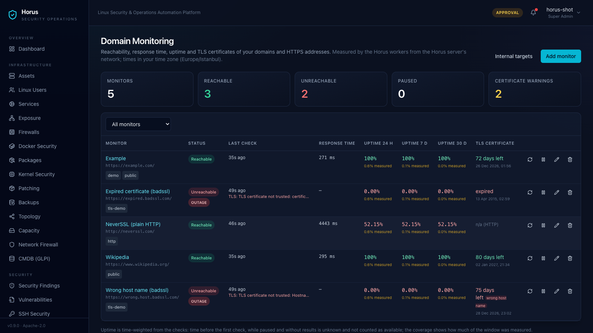
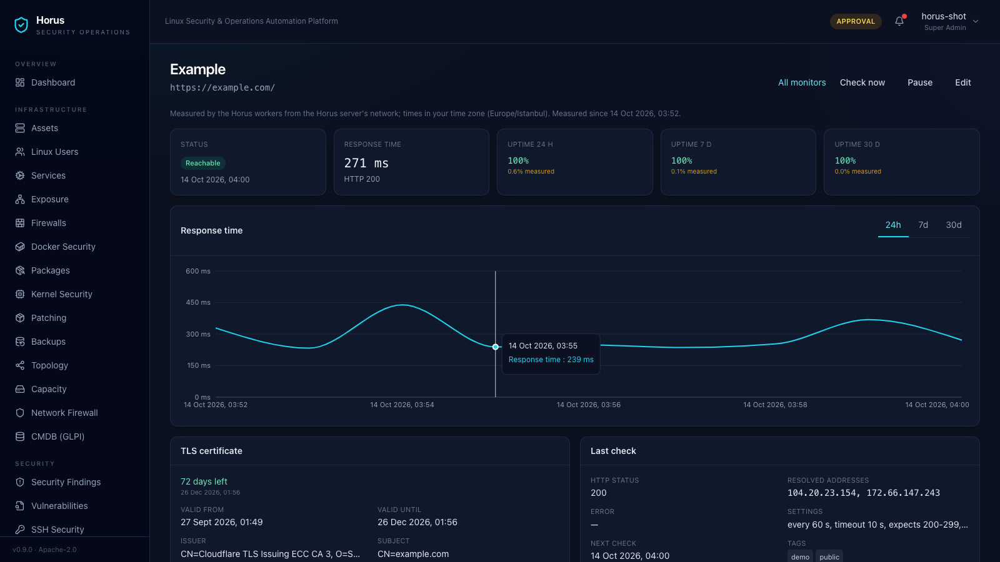

# Domain izleme

← [README'ye dön](../../README.tr.md) · [English](../en/domain-monitoring.md) | Türkçe

**Domain İzleme**, domainleri ve HTTP(S) adreslerini Horus sunucusundan kontrol eder: erişilebilirlik, yanıt süresi,
24 saat / 7 gün / 30 günlük uptime ve TLS sertifikası (bitiş tarihi, veren, zincir ve host adı). Her şey mevcut Horus
worker'ları, veritabanı, yetkileri ve bildirimleriyle çalışır - ek kurulum gerekmez.

- [Ne ölçülür](#ne-ölçülür)
- [İzleme ekleme](#izleme-ekleme)
- [Durum, uptime ve kapsam](#durum-uptime-ve-kapsam)
- [TLS sertifikaları](#tls-sertifikaları)
- [Bildirimler](#bildirimler)
- [İç ağ hedefleri ve SSRF koruması](#iç-ağ-hedefleri-ve-ssrf-koruması)
- [Yetkiler](#yetkiler)
- [Veri saklama](#veri-saklama)
- [Ayarlar](#ayarlar)

*Liste: durum, son kontrol ve hata, yanıt süresi, ölçüm kapsamıyla uptime, TLS bitiş tarihi.*

## Ne ölçülür

> [!IMPORTANT]
> Tüm değerler **Horus sunucusunun bulunduğu ağdan** ölçülür. Yalnızca bazı kullanıcılarınız için erişilemeyen ya da
> Horus sunucusunun ulaşamadığı bir site bu şekilde görünür. Tarayıcının yaptığı sorgular hiçbir zaman kanıt sayılmaz.

Bir worker'ın çalıştırdığı her kontrol:

1. host adını bir kez çözümler ve her adresi doğrular (bkz. [SSRF koruması](#iç-ağ-hedefleri-ve-ssrf-koruması));
2. yalnızca bu doğrulanmış adrese bağlanır - `https://` için TLS, SNI ve tam sertifika doğrulamasıyla;
3. hafif bir `GET` (`Connection: close`) gönderir ve **yalnızca durum satırını ve başlıkları** okur - gövde hiçbir
   zaman indirilmez;
4. en fazla 5 yönlendirmeyi izler; her hedef yeniden doğrulanır;
5. son HTTP durumunu beklenen kodlarla karşılaştırır (varsayılan `200-299`).

Hatalar **DNS**, **zaman aşımı**, **bağlantı**, **TLS**, **HTTP durumu**, **yönlendirme**, **engellenen hedef**,
**protokol** veya **geçersiz URL** olarak sınıflandırılır.

## İzleme ekleme

**Domain İzleme → İzleme ekle**:

| Alan | Varsayılan | Not |
|---|---|---|
| Ad | - | listelerde ve bildirimlerde gösterilir |
| Domain veya URL | - | `example.com` → `https://example.com/`; yalnızca `http://` / `https://`, kullanıcı adı veya parola içeremez |
| Kontrol aralığı | 60 sn | 30 sn - 24 sa |
| Zaman aşımı | 10 sn | 1 - 30 sn, aralıktan kısa |
| Beklenen HTTP durumu | `200-299` | kod ve aralıklar, ör. `200-299, 301` |
| Kaç başarısız kontrolde bildirim | 3 | kesinti bildirilmeden önceki ardışık başarısız kontrol sayısı |
| Etiketler | - | isteğe bağlı, filtreleme için |

İzlemeler düzenlenebilir, duraklatılabilir, yeniden başlatılabilir ve silinebilir. **Şimdi kontrol et**, bir worker
için anında kontrolü kuyruğa alır; izleme başına 30 saniyede bir ve kullanıcı başına 10 dakikada 20 ile sınırlıdır.

Tüm izlemelerin kontrolleri kendi aralıklarına dağıtılır ve sınırlı eşzamanlılıkla (`HORUS_MONITOR_CONCURRENCY`)
çalışır. Bir izleme hiçbir zaman aynı anda iki worker tarafından kontrol edilmez.

## Durum, uptime ve kapsam

| Durum | Anlamı |
|---|---|
| Erişilebilir | son kontrol başarılı |
| Erişilemiyor | son kontrol başarısız (hata türü ve mesajı gösterilir) |
| Kesinti | başarısız kontrol serisi bildirim eşiğine ulaştı |
| Duraklatıldı | kontrol edilmiyor; duraklatılmış süre ölçülmez |
| Henüz ölçülmedi | henüz hiç kontrol çalışmadı |

**Uptime** zaman ağırlıklıdır: bir kontrol sonucu bir sonraki sonuca kadar, ancak en fazla aralığın iki katı kadar
geçerli sayılır.

- **uptime %** = erişilebilir süre / (erişilebilir + erişilemeyen süre)
- **kapsam %** = (erişilebilir + erişilemeyen süre) / pencere

**İlk kontrolden önceki, duraklatılmış ve sonucu olmayan** süre (ör. durmuş bir worker) **bilinmiyor** sayılır ve
hiçbir zaman erişilebilir kabul edilmez. Bir saat önce eklenen bir izleme, 30 günlük pencerede uptime değerini yüzde
birkaçlık bir kapsamla gösterir - sahip olmadığı 30 günlük bir geçmişi göstermez. Pencereler tam UTC saat başlarına
hizalıdır. Zamanlar UTC olarak saklanır ve tarayıcınızın saat diliminde gösterilir.

Detay sayfasında yanıt süresi grafiği (24 saat için kontrol başına, 7 / 30 gün için saatlik ortalama), başlangıç,
bitiş ve süresiyle kesintiler, hata nedenleri, HTTP durumu ve çözümlenen IP adresleriyle kontrol geçmişi ve günlük
özetler bulunur.

*Tek bir izlemenin detayı: yanıt süresi, sertifika, çözümlenen adreslerle son kontrol, kontrol geçmişi.*

## TLS sertifikaları

`https://` adreslerinde sertifika SNI ile sorgulanır; zincir ve host adı TLS katmanı tarafından doğrulanır. Listede
bitiş tarihi ve kalan gün, detay sayfasında geçerlilik süresi, veren, konu, adlar ile zincir ve host adı doğrulama
sonuçları gösterilir. Doğrulanamayan bir sertifika kontrolü **başarısız** yapar (TLS); ayrıntıları istek gönderilmeyen
ayrı bir el sıkışmayla okunur - isteğin kendisi için doğrulama hiçbir zaman kapatılmaz. `http://` adreslerinde TLS
alanları **uygulanamaz** olarak gösterilir.

## Bildirimler

Bildirimler mevcut Horus bildirimlerini kullanır (uygulama içi ve yapılandırılmış E-posta / Slack / Teams / Webhook
kanalları ile yönlendirme kuralları). Uygulama içinde `monitors:read` yetkisine sahip kullanıcılar görür.

| Olay | Ne zaman | Tekrar |
|---|---|---|
| Kesinti | N ardışık başarısız kontrolden sonra (varsayılan 3) | kesinti başına bir kez |
| Düzelme | kesintiden sonraki ilk başarılı kontrol | bir kez |
| Sertifika süresi doluyor | bitişten 30, 14, 7, 3 ve 1 gün önce | eşik başına bir kez; sertifika yenilenince sıfırlanır |
| Sertifika süresi doldu | bitişten sonra | bir kez |
| Sertifika sorunu | güvenilmeyen zincir veya yanlış host adı | farklı her hata için bir kez |

Bildirim eşiği yalnızca ne zaman bildirim gönderileceğini belirler. Uptime her başarısız kontrolü her zaman
erişilemeyen süre olarak sayar.

## İç ağ hedefleri ve SSRF koruması

Varsayılan olarak yalnızca **genel internet adresleri** kontrol edilir. Reddedilenler: loopback, özel ağlar,
link-local, CGNAT, multicast, ayrılmış ve dokümantasyon aralıkları ile bulut metadata adresleri - IPv4 ve IPv6,
IPv6 içine gömülü IPv4 dahil (mapped, 6to4, Teredo, NAT64). Bir ad **yalnızca** izin verilen adreslere çözümlenmelidir;
bağlantı ardından doğrulanan adrese yapılır, böylece DNS rebinding bağlantıyı bir iç adrese çeviremez. Her
yönlendirme hedefi yeniden doğrulanır.

İç servisleri izlemek için `settings:write` yetkisine sahip bir kullanıcı **Domain İzleme → İç ağ hedefleri**
bölümünden ağ ekler: Horus'un izlemesine açıkça izin vermek istediğiniz iç ağın IP adresini veya CIDR değerini girin
(örnek yer tutucu: `<internal-cidr>` - kendi ağınızla değiştirin; host adları ve `0.0.0.0/0` reddedilir). Bulut
metadata adresleri bu durumda da engelli kalır. Değişiklikler denetim kaydına (audit log) yazılır.

## Yetkiler

| Yetki | İzin verdiği | Varsayılan roller |
|---|---|---|
| `monitors:read` | liste, detay, geçmiş | Super Admin, Security Admin, System Admin, Security Analyst, Auditor |
| `monitors:manage` | ekleme, düzenleme, duraklatma, devam ettirme, silme, şimdi kontrol et | Super Admin, Security Admin, System Admin |
| `settings:write` | iç ağ hedefleri izin listesi | Super Admin |

## Veri saklama

| Veri | Saklama |
|---|---|
| Ham kontrol sonuçları | 90 gün (`HORUS_MONITOR_RETENTION_DAYS`) |
| Saatlik özetler | ham sonuçlar kadar |
| Günlük özetler, kesintiler | izleme silinene kadar |

Günlük `horus.monitor_maintenance` görevi günlük özetleri yazar ve eski ham sonuçları temizler. Bir izlemeyi silmek
sonuçlarını, kesintilerini ve özetlerini kaldırır; denetim kaydı kimin neyi sildiğini saklar.

## Ayarlar

| Değişken | Varsayılan | Anlamı |
|---|---|---|
| `HORUS_MONITOR_CONCURRENCY` | `8` | bir dağıtım çalışmasında aynı anda çalışan kontrol sayısı |
| `HORUS_MONITOR_RETENTION_DAYS` | `90` | ham kontrol sonuçlarının ve saatlik özetlerin saklandığı gün (7 - 3650) |
